# Simulating the Demographic Transition

``` r

library(hammel)
library(tibble)
library(dplyr)
library(tidyr)
library(ggplot2)
```

The demographic transition was the transition from high mortality/high
fertility rates to low mortality/low fertility rates. Typically,
mortality rates fell before fertility rates, leading to a period of
sustained high population growth. This transition began in Europe and
other more developed countries in the nineteenth century and was
complete by the early twentieth century. The rest of the world
experienced an accelerated demographic transition beginning in the
mid-twentieth century.

To demonstrate Hammel’s capabilities, we will micro-simulate the
demographic transition in Sweden. Sweden provides a great example
because it has some of the best long-term historical data for tracking
fertility and mortality rates (among other things).

## Gather Inputs

For this exercise, historical age-specific fertility and mortality rates
are required. These rates can be found at the [Human Fertility
Database](https://www.humanfertility.org/) (HFD) and [Human Mortality
Database](https://www.mortality.org/) (HMD), respectively. We can use
the helper functions of `get_fertility_hfd` and `get_mortality_hmd` to
quickly get these rate schedules set up.

Both of these databases require a login to download data. To automate
this procedure, you can add the following to the `.Renviron` in your
home directory.

``` bash
HMD_USERNAME="username here"
HMD_PASSWORD="password here"
HFD_USERNAME="username here"
HFD_PASSWORD="password here"
```

If you have [usethis](https://usethis.r-lib.org/) installed, you can
`usethis::edit_r_environ(scope = "user")` to edit the file, although you
will also need to have a text editor set up in your options
(e.g. `options(editor = "nano")`).

Once the credentials are set up, we can download the data.

``` r

fertility_rates_sweden <- get_fertility_hfd("SWE", 1891:2024)
mortality_rates_sweden <- get_mortality_hmd("SWE", 1751:2024, open_age = 85)
```

We are downloading the entire series here for both mortality and
fertility. Mortality rates go back to 1751 and fertility rates go back
to 1891. Age-specific mortality rates from the HMD use the 110 age
category as the default open-ended category. However, in historical data
this can sometimes lead to missing values at the oldest ages, so we
truncate the open age category to 95 with the `open_age = 85` argument.
The function will download death and exposure counts to estimate the
mortality rate in this open-ended age category correctly.

Lets take a peak at one of these schedules.

``` r

fertility_rates_sweden
#> # A tibble: 5,896 × 5
#>    age_start age_end    rate time_start time_end
#>        <dbl>   <dbl>   <dbl>      <int>    <dbl>
#>  1        12      13 0             1891     1892
#>  2        13      14 0.00002       1891     1892
#>  3        14      15 0.00002       1891     1892
#>  4        15      16 0.00046       1891     1892
#>  5        16      17 0.0021        1891     1892
#>  6        17      18 0.00636       1891     1892
#>  7        18      19 0.0157        1891     1892
#>  8        19      20 0.0338        1891     1892
#>  9        20      21 0.0609        1891     1892
#> 10        21      22 0.0823        1891     1892
#> # ℹ 5,886 more rows
```

The output shows the typical structure of rate schedules used by
`hammel`. All rate schedules require `age_start` and `age_end` columns
to define age bands using the half-open intervals of
`[age_start, age_end)`.[^1] Open-ended intervals can be indicated by
using `Inf` for `age_end`. The `rate` column contains the actual rate.
These are true rates defined by events over person-years, not
probabilities.

Rate schedules can be stratified by other variables. In this case, we
are using `time_start` and `time_end` to stratify the rate schedules by
time period, using one year time periods of `[time_start, time_end)`.
Other stratification is possible, but we will not use it here for
fertility. The mortality schedules always require an additional
stratification variable of `sex` (with “m” and “f” categories).

The fertility rates we have here start a bit late. Mortality decline was
already well under way by 1891, so if we only start in 1891 we will miss
a lot of the important action. We are going to cheat a bit here by
extending the 1891 fertility schedule backwards to 1751 as well,
treating it as if it was constant over this time period. This is not
strictly true, but most of the fertility decline in Sweden happened
after 1891 so this will give us a reasonable approximation for this
demonstration.

``` r

fertility_rates_sweden <- bind_rows(
  # add an additional row with 1891 values that extends from 1751 to 1891
  fertility_rates_sweden |>
    filter(time_start == 1891) |>
    mutate(time_start = 1751, time_end = 1891),
  fertility_rates_sweden
)
```

Lets take a look at the implied total fertility rate (TFR) from these
input rates. We can can do this using the `calculate_tfr` helper
function which is designed to work on both input rate schedules and
simulation output from the `calculate_fertility_rates` function. It will
automatically detect stratification variables and calculate TFR within
each stratum (in this case time periods).

``` r

fertility_rates_sweden |>
  calculate_tfr() |>
  ggplot(aes(x = time_start + 0.5, y = tfr)) +
  geom_line() +
  labs(x = "year", y = "total fertility rate")
```

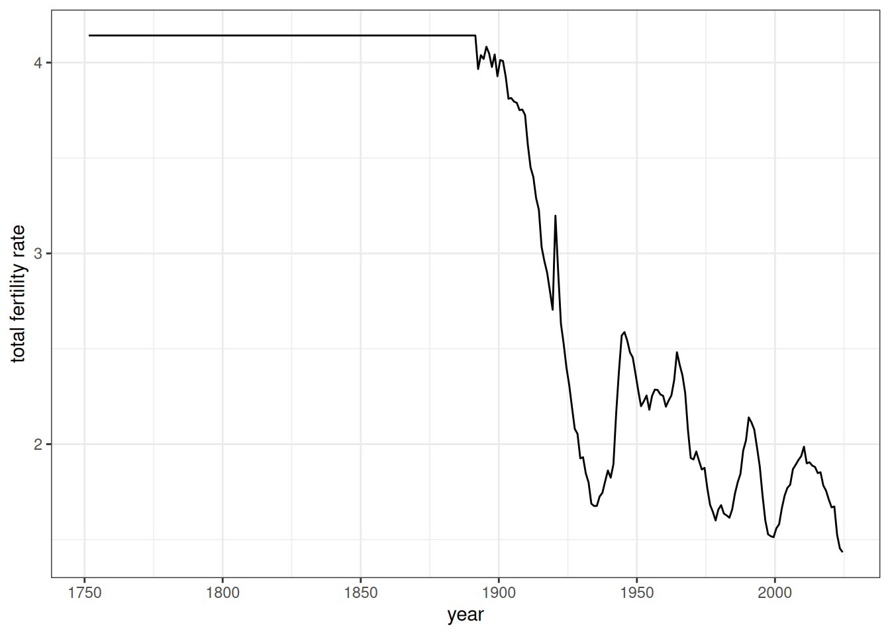

Figure 1: Total fertility rate in Sweden over the time period. Values
before 1891 have been extended from the 1891 values.

[Figure 1](#fig-tfr-input) shows a dramatic drop in fertility from 1891
through the pre-WWII era, as well as a baby boom in the immediate
post-WWII era. Also we can see the flat line produced before 1891 due to
our projecting the 1891 backwards.

Now lets look at the life expectancy at birth from the mortality
schedule using the similar `calculate_life_table` helper function.

``` r

mortality_rates_sweden |>
  calculate_life_table() |>
  filter(age_start == 0) |>
  ggplot(aes(x = time_start + 0.5, y = ex, color = sex)) +
  geom_line() +
  labs(x = "year", y = "life expectancy at birth")
```

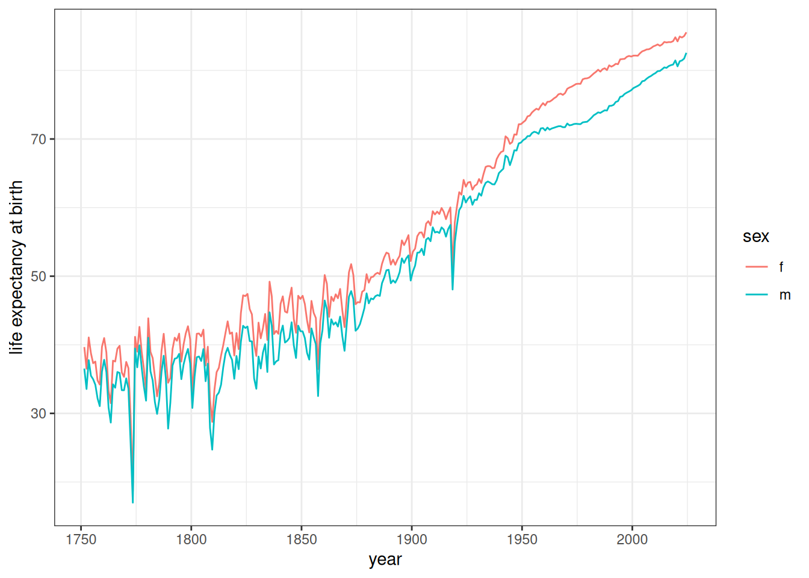

Figure 2: Life expectancy in Sweden by sex over the time period.

[Figure 2](#fig-lifeexp-input) shows the expected increase in life
expectancy over the time period, particularly after 1800. The early
period is characterized by much more volatility from year to year as
well. Throughout the time period we can see the women have a higher life
expectancy than men.

## Initialize the Starting Population

We now need to determine where to start my simulation and how to
generate the starting population. We choose 1780 as the starting point
because this time point will include some of the early period before
mortality started to substantially decline, providing a better pre and
post illustration.

I can create a starting population with the `create_baseline_population`
function. However, this function will create a population that is
uniformly distributed by age up to the `max_age` argument. Typically,
the best approach is to run a simulation for a certain number of years
at constant rates to produce a stable population distribution. We call
this the “burn in” period.

To burn in a starting population, we need to select a set of mortality
and fertility rates. We want to choose these schedules from among the
pre-transition years in order to create a more or less stationary
population (e.g. zero growth rate). After some experimentation, I
determined that pairing the 1891 fertility rates with the 1811 mortality
rates produces a stable population with a nearly zero growth rate. The
appendix includes details on how this was determined.

I can now run a “burn in” simulation over 100 years to produce my
desired starting population. To do this I start with a uniform
distribution by age and then simulate this population forward.

``` r

# get stationary rates, remove time variables to avoid errors
fert_rates <- fertility_rates_sweden |>
  filter(time_start == 1891) |>
  select(-starts_with("time_"))
mort_rates <- mortality_rates_sweden |>
  filter(time_start == 1811) |>
  select(-starts_with("time_"))

# The starting population should have ending times equal to my start date - 100
pop <- generate_uniform_population(100000, 70, 1780 - 100)

# set up the model
model <- hammel_model() |>
  set_population(pop) |>
  set_fertility(fert_rates) |>
  set_mortality(mort_rates) |>
  set_union_formation("on_demand")

# simulate for 100 years to get my starting population
pop_start <- run_simulation(model, 100, seed = 1)
```

When I create the uniform population, we need to specify `end_time`.
Birth times for the randomly generated population will extend backwards
from this value, so this will give the starting year for my simulation.
Since we want the real simulation to start in 1780 and we want to
project forward this burn in simulation 100 years, this argument needs
to be 1680.

When setting up the model, the only three required processes are
fertility, mortality, and union formation. In this case, we are not
interested in a detailed tracking of marriages and so we will use the
“on_demand” method. This just generates a union whenever a currently
unpartnered woman gives birth.

Lets take a look at the population size of this simulation over the time
period using the `calculate_population_size` helper function.

``` r

calculate_population_size(pop_start, 1680:1780) |>
  ggplot(aes(x = time, y = population)) +
  geom_line() +
  labs(x = "year")
```

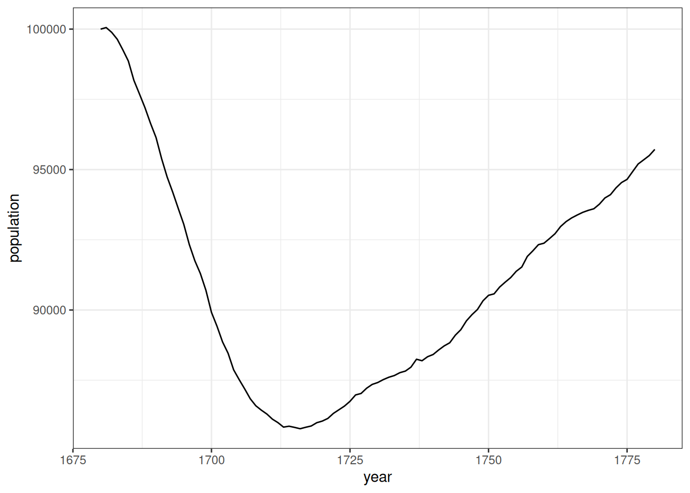

Figure 3: Population size of the burn in simulation at yearly intervals

[Figure 3](#fig-pop-size-burn-in) shows that there is an initial drop in
the population size in the early period of the simulation before it
stabilizes in the early 1700s and seems to grow at a fairly constant and
low rate. This early drop is anticipated because the initial population
provided was not a stable population distribution and over-represented
older individuals that quickly die off in this high mortality
environment.

As a final check, lets look at the annual growth rate of this population
over the time period.

``` r

calculate_population_size(pop_start, 1680:1780) |>
  mutate(growth_rate = log(lead(population) / population)) |>
  ggplot(aes(x = time, y = growth_rate)) +
  geom_line() +
  geom_smooth(se = FALSE) +
  labs(x = "year", y = "population growth rate")
```

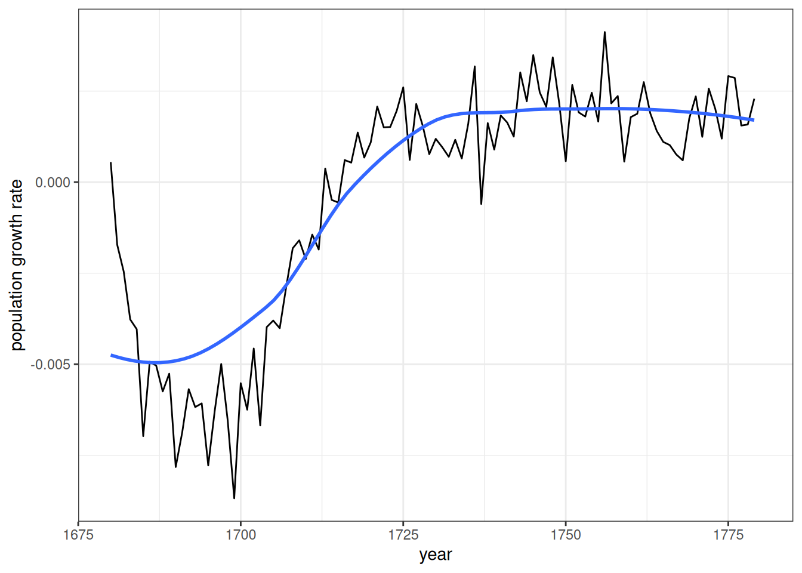

Figure 4: Annual population growth of the burn in simulation at yearly
intervals. Smoother shown in blue.

[Figure 4](#fig-pop-growth-burn-in) shows that the population growth
rate is settling into a low positive growth rate, with some year to year
noise, by the mid-point of the burn-in period, as we would expect of a
stable population.

## Run the Simulation

We are now ready to run the simulation. To do this we just need to use
the time-varying rate schedules. The simulation will pick up the correct
rates to use in each year of the simulation. We will run the simulation
from 1780 to 2020. Note that the rate schedules extend beyond these time
points, but we don’t need to trim them to just the time period we want.

``` r

model <- hammel_model() |>
  # use the starting population we just created
  set_population(pop_start) |>
  # feed in the time-varying rate schedules
  set_fertility(fertility_rates_sweden) |>
  set_mortality(mortality_rates_sweden) |>
  # on demand is fine because our focus is on the fertility and mortility
  set_union_formation("on_demand")
sim_time <- system.time(
  pop_final <- run_simulation(model, 2020 - 1780, seed = 1)
)
```

The simulation took 38.911 seconds to run.

## Analyze the Simulation Results

Lets start by looking at the population size over the time period of the
simulation.

``` r

pop_final |>
  calculate_population_size(1780:2020) |>
  ggplot(aes(x = time, y = population / first(population))) +
  geom_line() +
  labs(x = "year", y = "population size relative to initial")
```

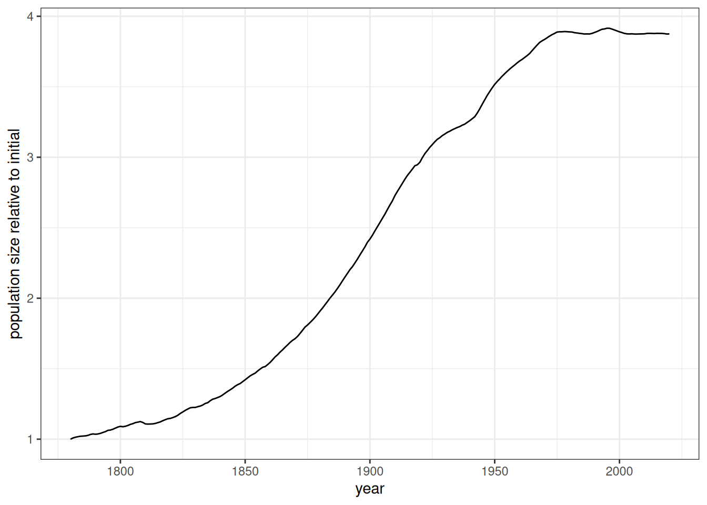

Figure 5: Relative population size from start from simulation starting
in 1780 to 2020, using Sweden’s historic age-specific fertility and
mortality rates

[Figure 5](#fig-pop-size-demog-trans) displays the classic S-shaped
curve expected of the demographic transition, although we start late
enough in 1780 that it is already rising a bit at the beginning. The
population grows by four-fold over the simulation period.

Another classic representation of the demographic transition is to
display the crude birth and death rates over time. These rates are
constructed by taking the number of births or deaths divided by the
mid-year population. Because the simulation is a continuous time
simulation, `calculate_population_size` does not complain about
non-integer time values.

``` r

births <- pop_final$persons |>
  mutate(year = floor(birth_time)) |>
  count(year, name = "births")
deaths <- pop_final$persons |>
  mutate(year = floor(death_time)) |>
  count(year, name = "deaths")
crude_rates <- calculate_population_size(pop_final, 1780:2019 + 0.5) |>
  mutate(year = floor(time)) |>
  left_join(births, by = "year") |>
  left_join(deaths, by = "year") |>
  mutate(rate_birth = births / population, rate_death = deaths / population) |>
  pivot_longer(cols = starts_with("rate_"), names_prefix = "rate_",
               names_to = "event", values_to = "crude_rate")

crude_rates |>
  ggplot(aes(x = time, y = crude_rate, color = event)) +
  geom_line() +
  labs(x = "year", y = "crude rate")
```

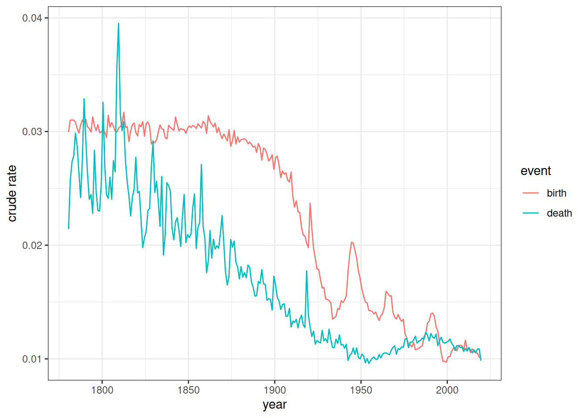

Figure 6: Crude birth and death rates annually over the simulation

[Figure 6](#fig-crude-rates-demog-trans) illustrates why population
growth occurs during the demographic transition. Death rates fall first
followed after a delay by birth rates. The difference in rates due to
that lag generates sustained population growth during the transition.

Next, we can use the `calculate_fertility_rates` helper function to
estimate age-specific fertility rates in each year of the simulation and
convert these into total fertility rates with the `calculate_tfr`
function. Like all of the `calculate_*_rates` helper functions,
`calculate_fertility_rates` will calculate events and person-years lived
within lexis triangles, based on the age and time breaks provided by the
user. It can also be stratified by the same variables that are used to
stratify input rates and produces an object of the same structure as the
input rates, making comparison straightforward.

``` r

input_tfr <- fertility_rates_sweden |>
  calculate_tfr()

pop_final |> 
  calculate_fertility_rates(time_breaks = 1780:2020, age_breaks = 12:55) |>
  calculate_tfr() |>
  ggplot(aes(x = time_start, y = tfr)) +
  geom_line() +
  geom_line(data = input_tfr, linetype = 2, color = "red") +
  scale_x_continuous(limits = c(1780, 2020)) +
  labs(x = "year", y = "total fertility rate")
```

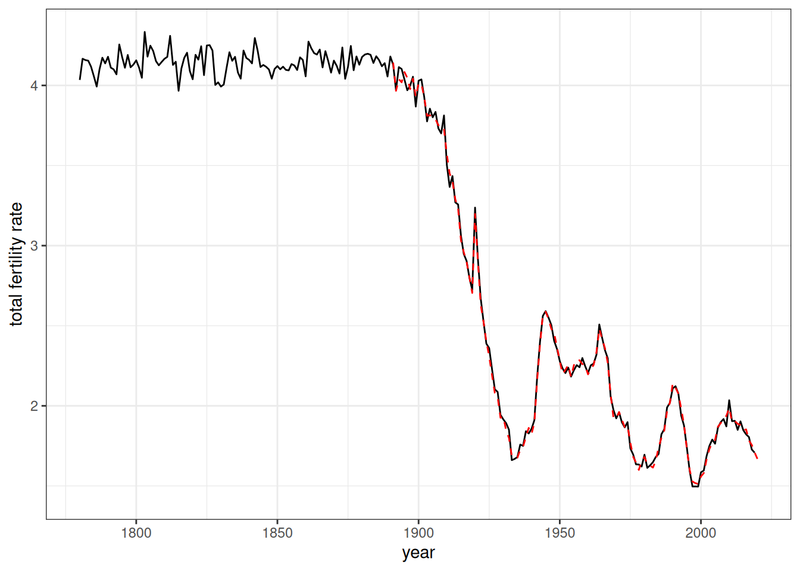

Figure 7: Total fertility rates by year of the simulation. Dotted red
line shows the total fertility rate from the input rates.

[Figure 7](#fig-tfr-demog-trans) shows the estimated TFR for each year
of the simulation. The dotted red line shows the TFR from the input
rates. The estimated TFRs match closely to that expected by the input
rates. There is also less random noise at the end of the simulation when
the population is much larger.

We can now do the same procedure for life expectancy at birth, using the
`calculate_mortality_rates` helper function to get age-specific rates by
sex and then feeding those into the `calculate_life_table` function.

``` r

input_lifeexp <- mortality_rates_sweden |>
  calculate_life_table() |>
  filter(age_start == 0)

pop_final |>
  calculate_mortality_rates(time_breaks = 1780:2020, age_breaks = 0:85) |>
  calculate_life_table() |>
  filter(age_start == 0) |>
  ggplot(aes(x = time_start, y = ex)) +
  geom_line() +
  geom_line(data = input_lifeexp, linetype = 2, color = "red") +
  facet_wrap(~sex) +
  scale_x_continuous(limits = c(1780, 2020)) +
  labs(x = "year", y = "life expectancy at birth")
```

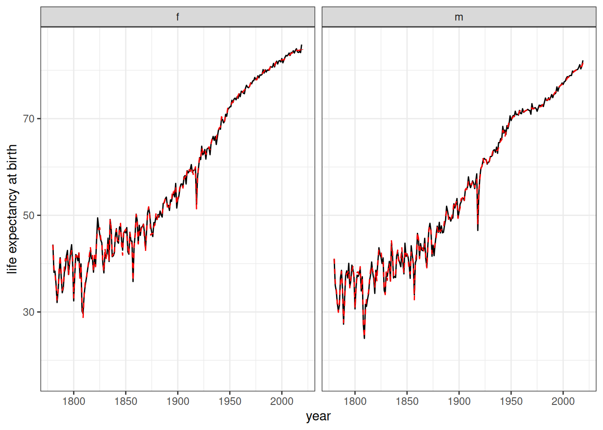

Figure 8: Life expectancy at age zero by year of the simulation,
separately by gender. Dotted red lines show the life expectancy at birth
from input rates.

[Figure 8](#fig-life-exp-demog-trans) shows the estimated life
expectancy at birth for each year of the simulation. The dotted red line
shows the life expectancy at birth from the input rates. The estimated
life expectancy matches closely to that expected by the input rates.

``` r

count_kin(pop_final, seq(1780, 2020, 5), relationship = "first_cousin") |>
  ggplot(aes(x = time, y = mean_kin)) +
  geom_line() +
  labs(x = "year", y = "mean number of living first cousins")
```

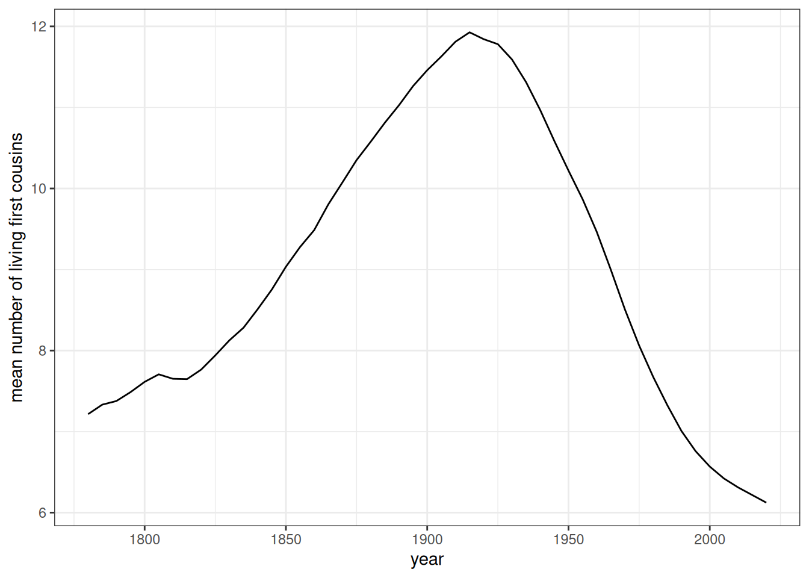

Figure 9: Mean number of living cousins across time in the simulation.

Finally, [Figure 9](#fig-cousins) gets at one of the main reasons that
SOCSIM was originally developed. The demographic transition led to first
a rise in the number of living first cousins per person as mortality
declined and then a sharp decline as fertility declined. This is the
kind of kinship relation insight that demographic microsimulation is
very good at uncovering.

### Compare specific age-specific rate schedules

As a final test, I look at age-specific mortality rates and age-specific
fertility rates at specific time points and compare them to the input
rates at those time points. For this exercise, I can also use the
`conf.level = 0.95` argument of the `calculate_fertility_rates` and
`calculate_mortality_rates` helper functions to get 95% confidence
intervals for each estimate. These confidence intervals are Poisson
confidence intervals rather than a normal distribution approximation and
should therefore be accurate even for small exposure counts in cells.
Because we are looking at age (and sex, for mortality) cells by year,
the estimates here are more noisy than for summary measures like TFR or
life expectancy.

``` r

selected_years <- c(1900, 1920, 1940, 1960, 1980, 2000)
temp <- fertility_rates_sweden |>
  filter(time_start %in% selected_years)

calculate_fertility_rates(pop_final, 1780:2020, 12:55, conf_level = 0.95) |>
  filter(time_start %in% selected_years) |>
  ggplot(aes(x = age_start + 0.5, y = rate_fertility)) +
  geom_ribbon(aes(ymin = conf_low, ymax = conf_high),
              color = NA, fill = "grey70") +
  geom_point(size = 0.5) +
  geom_line(data = temp, aes(y = rate), linetype = 2, color = "red") +
  facet_wrap(~time_start) +
  labs(x = "age", y = "age-specific fertility rate")
```

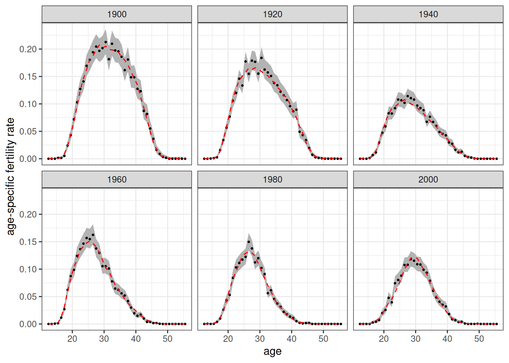

Figure 10: Age-specific fertility rates estimated from simulation for
selected years. 95% confidence band shown around each estimate. Dotted
red line shows input rate.

[Figure 10](#fig-asfr-demog-trans) shows the estimated fertility rates
at 20 year intervals from 1900 to 2000. Dotted red lines show the values
from the input rates. The red dotted line fits well to the estimated
data and is generally within the 95% confidence interval, as we would
expect.

``` r

selected_years <- c(1800, 1850, 1900, 1950, 2000)
temp <- mortality_rates_sweden |>
  filter(time_start %in% selected_years)

calculate_mortality_rates(pop_final, 1780:2020, 0:85, conf_level = 0.95) |>
  filter(time_start %in% selected_years) |>
  ggplot(aes(x = age_start + 0.5, y = rate_mortality)) +
  geom_ribbon(aes(ymin = conf_low, ymax = conf_high),
              color = NA, fill = "grey70") +
  geom_point(size = 0.5) +
  geom_line(data = temp, aes(y = rate), linetype = 2, color = "red") +
  facet_grid(sex ~ time_start) +
  scale_y_log10() +
  labs(x = "age", y = "age-specific mortality rate")
```

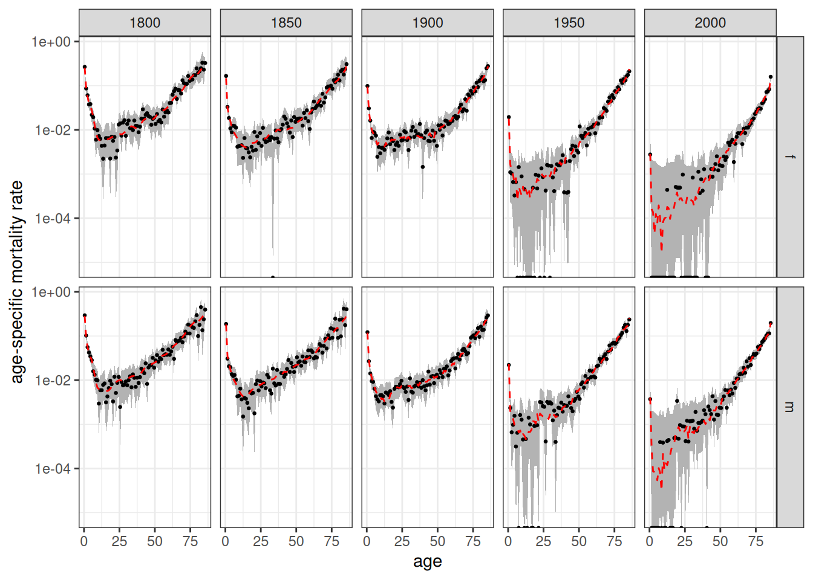

Figure 11: Age-specific mortality rates by sex estimated from simulation
for selected years. 95% confidence band shown around each estimate.
Dotted red line shows input rate.

[Figure 11](#fig-asmr-demog-trans) shows the estimated mortality rates
at 50 year intervals from 1800 to 2000. Dotted red lines show the values
from the input rates. In the more recent years, very low mortality rates
at some younger ages lead to no observed deaths in some single year age
groups, resulting in wide confidence bands. In general, the red dotted
lines fits well to the estimated data and are generally within the 95%
confidence interval.

## Appendix: Determine Stationary Population Rates

We want to start the simulation with a population age structure from a
stable but stationary population. To do so, we need to find mortality
rates to match with the 1891 fertility rates that will produce roughly
zero population growth in the stable population. We use the
approximation that:

\\r = \log(NRR)/\mu\\

Where \\NRR\\ is the net reproduction ratio and \\\mu\\ is the mean age
of childbearing. The code below creates a small function to generate the
growth rate from this formula given a set of fertility and mortality
schedules. We use it to test different candidates until we get one that
is close to a zero growth rate.

``` r

get_growth_rate <- function(fert, mort) {

  NRR <- mort |> 
    calculate_life_table() |>
    filter(sex == "f") |>
    select(age_start, Lx) |>
    right_join(fert, by = c("age_start")) |>
    mutate(prod = Lx * rate) |>
    pull(prod) |>
    sum() * 0.4886
  mu <- sum((fert$age_start + 0.5) * fert$rate) / sum(fert$rate)

  log(NRR) / mu
}

fert <- fertility_rates_sweden |> filter(time_start == 1891)
get_growth_rate(fert, mortality_rates_sweden |> filter(time_start == 1810))
#> [1] -4.006647e-05
get_growth_rate(fert, mortality_rates_sweden |> filter(time_start == 1812))
#> [1] 0.003415242
get_growth_rate(fert, mortality_rates_sweden |> filter(time_start == 1813))
#> [1] 0.004139684
get_growth_rate(fert, mortality_rates_sweden |> filter(time_start == 1838))
#> [1] 0.007024606
get_growth_rate(fert, mortality_rates_sweden |> filter(time_start == 1811))
#> [1] 0.001886827
```

The 1811 mortality rates produces a very low but slightly positive
growth rate when paired with the 1891 fertility rates, so we will use
this set of rates to create the starting stable population.

[^1]: Ok, technically not *all*, because some rate schedules can use
    duration dependence rather than age dependence, in which case they
    use `dur_start` and `dur_end` instead. Fertility and mortality are
    always age-based.
