# Introduction to Hammel

``` r

library(hammel)
library(tibble)
library(dplyr)
library(tidyr)
library(stringr)
library(ggplot2)
library(tictoc)
```

## Rate Schedules

Hammel is primarily built around various “rate schedules” that define
the frequency with which events happen to the people within the
simulation. [Table 1](#tbl-rate-schedules) describes all six available
rate schedules along with additional information.

| Rate process | Age/duration bands¹ | Required strata | Optional strata | Can vary by time?² |
|----|----|----|----|----|
| Fertility | age | none | groups; union type; parity bands³ | yes |
| Mortality | age | sex | groups | yes |
| Union formation (mate search) | age or duration | none | groups; previous union | yes |
| Union dissolution | duration | none | partner groups; union type | yes |
| Cohabitation-to-marriage conversion | age or duration | none | groups | yes |
| Group transitions | age or duration | origin; destination | other groups; sex; union type | yes |
| ¹ Bands are half-open \[start, end), measured in years. Use age_start/age_end or dur_start/dur_end. Joint age-by-duration surfaces are not supported. |  |  |  |  |
| ² Stratify rates by half-open \[time_start, time_end) intervals to allow for variation in rates over time. |  |  |  |  |
| ³ Parity bands use half-open \[parity_start, parity_end) intervals and describe current maternal parity. |  |  |  |  |

Table 1: Rate schedules used by Hammel, along with available
age/duration bands, and required and optional stratifying variables.

Fertility and mortality are required in all simulations, and some
process is required for union formation although it may or may not
require a rate schedule (more on that below).

At its core, each rate schedule is a dataset with at least three
variables:

- `age_start`/`age_end` or `dur_start`/`dur_end` variables which define
  the age/duration bands for the rate schedules.
- A `rate` variable that defines the hazard rate of the event within the
  age/duration band, specified in terms of events per person-year (or
  union-year) lived.

Here is an example of a rate schedule for US fertility in 2000, provided
with the package:

``` r

usa_2000_fertility
#> # A tibble: 6 × 3
#>   age_start age_end   rate
#>       <int>   <int>  <dbl>
#> 1        15      20 0.0477
#> 2        20      25 0.110 
#> 3        25      30 0.114 
#> 4        30      35 0.0912
#> 5        35      40 0.0397
#> 6        40      45 0.008
```

Importantly, rates may be stratified by additional variables as
described in [Table 1](#tbl-rate-schedules). This stratification allows
for much more detailed and complex microsimulation. We will return to
this feature below, but first a simple example will establish the basic
workflow for simulating populations with hammel.

## A Simple Example

For this example, we will use only static fertility and mortality rates
defined across the entire population. The package comes with
age-specific fertility and mortality rates for the US in 2000. We can
use the `calculate_tfr` and `calculate_life_expectancy` functions to see
the implied total fertility rates and life expectancy at birth from
these rate schedules.

``` r

calculate_tfr(usa_2000_fertility)
#> # A tibble: 1 × 3
#>   age_start age_end   tfr
#>       <int>   <int> <dbl>
#> 1        15      45  2.05
calculate_life_expectancy(usa_2000_mortality)
#> # A tibble: 2 × 3
#>   sex     age    ex
#>   <chr> <int> <dbl>
#> 1 f         0  79.4
#> 2 m         0  74.0
```

US fertility in 2000 was at about replacement level given the high life
expectancy, which should lead to a roughly stationary population if
these rates were held constant over time.

To run a simulation with these rate schedules, we first need to create
an empty `hammel_model` object and then attach the fertility and
mortality processes to it. The functions for building this model are set
up to use a piping interface.

``` r

model <- hammel_model() |>
  set_fertility(usa_2000_fertility) |>
  set_mortality(usa_2000_mortality)
```

Now, we have a basic simulation model set up. However, we still need two
additional components before we are ready to simulate. The model
requires some process for union formation and it requires a starting
population.

Lets tackle union formation first. For this simple example, we are going
to forgo a full rate schedule and instead use the “on_demand” method of
union formation. This method simply creates a union whenever a currently
unpartnered woman has a birth. In effect, it treats every marriage as a
“shotgun wedding.” This is not a realistic model of union formation, but
it may be sufficient for many types of simulation where the goal does
not require accurate union formation simulation (e.g. kinship
reconstruction).

``` r

model <- model |>
  set_union_formation("on_demand")
```

Now we can set up a starting population. To do this, we will use the
`genrate_uniform_population` function which generates a population
uniformly distributed within some age range. This will not produce
realistic population age distributions, but allows us to get a foothold
for the simulation. In most cases, users will want to start a simulation
with a “burn in” period to allow this uniform distribution to become a
stable population.

``` r

pop_initial <- generate_uniform_population(50000, max_age = 70, end_time = 0)
model <- model |>
  set_population(pop_initial)
```

The `pop_initial` object is a `hammel_population` that includes several
elements:

``` r

str(pop_initial)
#> List of 3
#>  $ persons : tibble [50,000 × 6] (S3: tbl_df/tbl/data.frame)
#>   ..$ person_id : int [1:50000] 1 2 3 4 5 6 7 8 9 10 ...
#>   ..$ sex       : chr [1:50000] "f" "f" "m" "m" ...
#>   ..$ birth_time: num [1:50000] -45.4 -41.1 -33.9 -64 -69.9 ...
#>   ..$ death_time: num [1:50000] NA NA NA NA NA NA NA NA NA NA ...
#>   ..$ mother_id : int [1:50000] NA NA NA NA NA NA NA NA NA NA ...
#>   ..$ father_id : int [1:50000] NA NA NA NA NA NA NA NA NA NA ...
#>  $ unions  : tibble [0 × 6] (S3: tbl_df/tbl/data.frame)
#>   ..$ union_id  : int(0) 
#>   ..$ wife_id   : int(0) 
#>   ..$ husband_id: int(0) 
#>   ..$ start_time: num(0) 
#>   ..$ end_time  : num(0) 
#>   ..$ end_reason: chr(0) 
#>  $ end_time: num 0
#>  - attr(*, "class")= chr "hammel_population"
```

The `persons` tibble is the key element as it defines our existing
population of 10,000 people. The `unions` tibble is empty because the
entire population starts unmarried (expect a lot of weddings in the
first few years!). The `end_time` numeric value is important because it
defines the starting time for the simulation. I have set it to zero here
so that the origin point of our simulation is time zero. Users who want
more detailed starting populations can recreate this structure by hand.

We are now ready to run the simulation with the `run_simulation`
function. I will also time it with the
[tictoc](https://github.com/jabiru/tictoc) package.

``` r

tic()
pop_end <- run_simulation(model, years = 100, seed = 42)
toc()
#> 1.181 sec elapsed
```

Pretty fast! Lets look at its structure.

``` r

str(pop_end)
#> List of 6
#>  $ persons          : tibble [121,579 × 6] (S3: tbl_df/tbl/data.frame)
#>   ..$ person_id : num [1:121579] 1 2 3 4 5 6 7 8 9 10 ...
#>   ..$ sex       : chr [1:121579] "f" "f" "m" "m" ...
#>   ..$ birth_time: num [1:121579] -45.4 -41.1 -33.9 -64 -69.9 ...
#>   ..$ death_time: num [1:121579] 39.3 26.2 51.2 21.2 24.3 ...
#>   ..$ mother_id : num [1:121579] NA NA NA NA NA NA NA NA NA NA ...
#>   ..$ father_id : num [1:121579] NA NA NA NA NA NA NA NA NA NA ...
#>  $ unions           : tibble [33,742 × 6] (S3: tbl_df/tbl/data.frame)
#>   ..$ union_id  : num [1:33742] 1 2 3 4 5 6 7 8 9 10 ...
#>   ..$ wife_id   : num [1:33742] 27244 46788 26192 18379 30294 ...
#>   ..$ husband_id: num [1:33742] 29525 11269 24579 40836 4584 ...
#>   ..$ start_time: num [1:33742] 0.000894 0.001535 0.001645 0.003342 0.003843 ...
#>   ..$ end_time  : num [1:33742] 34 24.7 16.1 36.9 30.2 ...
#>   ..$ end_reason: chr [1:33742] "death_husband" "death_husband" "death_husband" "death_husband" ...
#>  $ end_time         : num 100
#>  $ simulation       :List of 4
#>   ..$ start_time    : num 0
#>   ..$ end_time      : num 100
#>   ..$ birth_interval: num 0.75
#>   ..$ ffab          : num 0.489
#>  $ unrealized_births: tibble [0 × 5] (S3: tbl_df/tbl/data.frame)
#>   ..$ period_start     : num(0) 
#>   ..$ period_end       : num(0) 
#>   ..$ age_start        : num(0) 
#>   ..$ age_end          : num(0) 
#>   ..$ unrealized_births: num(0) 
#>  $ unrealized_since : num 0
#>  - attr(*, "class")= chr "hammel_population"
```

Note that the output of the simulation is a `hammel_population` object
with the same basic structure as `pop_initial` as well as some
additions. Importantly, the output of one simulation can be the input
for another simulation. So, I could continue this simulation by setting
`pop_end` as my new starting population in the model.

I can use some nice convenience functions to analyze my simulation
results. The first thing that I will do is look at population size over
time.

``` r

pop_end |>
  calculate_population_size(0:100) |>
  ggplot(aes(x = time, y = population)) +
  geom_line()
```

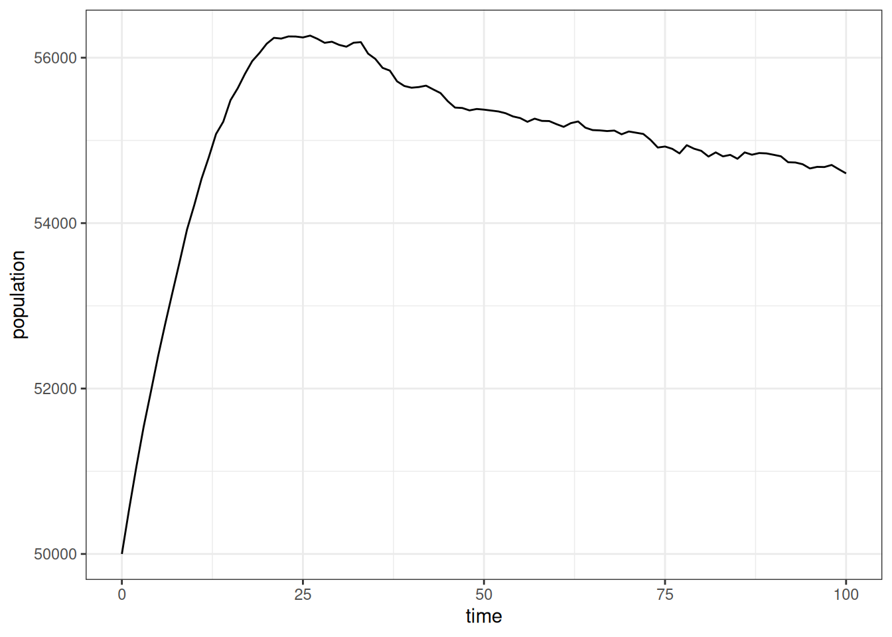

Figure 1: Population size over time in the simulation

Initially, the population grew rapidly due to the unusual age
distribution, but then it leveled off into a slowerm, fairly constant
growth rate that suggests a stable population. I can look at that
population growth rate more directly.

``` r

pop_end |>
  calculate_population_size(0:100) |>
  mutate(growth = log(population / lag(population))) |>
  ggplot(aes(x = time, y = growth)) +
  geom_line() +
  geom_smooth(se = FALSE)
```

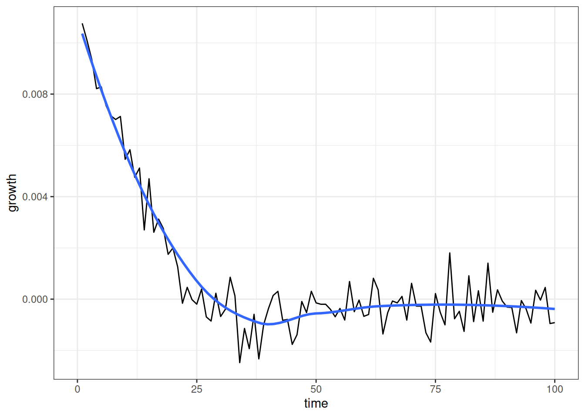

Figure 2: Annual population growth in the simulation, by year

[Figure 2](#fig-pop-growth-basic) shows that the annual growth rate
quickly drops from a positive rate to something very close to zero as we
approah not only a stable population, but one that is largely
stationary.

Do the age-specific fertility and mortality rates from the simulation
match our expectations? We can check this with
`calculate_fertility_rates` and `calculate_mortality_rates`. These
functions are part of a family of functions that calculate rates from
the events and person/union-years lived within lexis triangles, based on
the simulation history.

Lets first look at fertility rates.

``` r

calculate_fertility_rates(
  pop_end,
  # do the whole simulation as one time group
  time_breaks = c(0, 100),
  # use the same age breaks as input rates to compare
  age_breaks = seq(15, 45, 5),
  conf_level = 0.95
)
#> # A tibble: 7 × 10
#>   time_start time_end sex   age_start age_end person_years births rate_fertility
#>        <dbl>    <dbl> <chr>     <dbl>   <dbl>        <dbl>  <dbl>          <dbl>
#> 1          0      100 f            15      20      174752.   8472        0.0485 
#> 2          0      100 f            20      25      174671.  19077        0.109  
#> 3          0      100 f            25      30      174730.  19959        0.114  
#> 4          0      100 f            30      35      174686.  15938        0.0912 
#> 5          0      100 f            35      40      174089.   6747        0.0388 
#> 6          0      100 f            40      45      173308.   1386        0.00800
#> 7          0      100 f            45     Inf     1231033.      0        0      
#> # ℹ 2 more variables: conf_low <dbl>, conf_high <dbl>
```

I am using a single time period here to get pooled rates over time, but
you could also split this into different time periods. I match the age
breaks to my input rates. Note that it always adds an open-ended
category at the end.

Lets compare these rates directly to the input rates that we provided.

``` r

calculate_fertility_rates(
  pop_end,
  # do the whole simulation as one time group
  time_breaks = c(0, 100),
  # use the same age breaks as input rates to compare
  age_breaks = seq(15, 45, 5),
  conf_level = 0.95
) |>
  filter(age_end < Inf) |>
  ggplot(aes(x = age_start + 2.5, y = rate_fertility)) +
  geom_ribbon(aes(ymin = conf_low, ymax = conf_high),
              color = NA, fill = "grey70") +
  geom_point(size = 0.5) +
  geom_line(data = usa_2000_fertility, aes(y = rate),
            linetype = 2, color = "red") +
  labs(x = "age", y = "age-specific fertility rate")
```

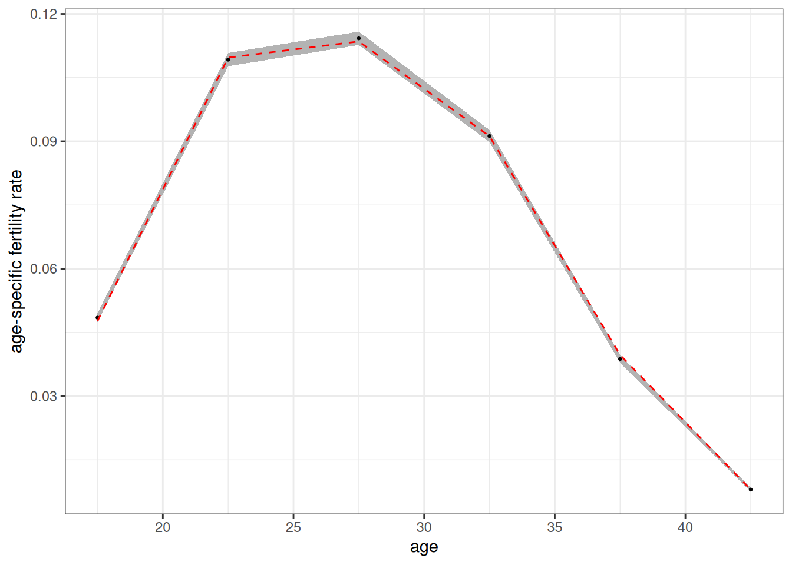

Figure 3: Age-specific fertility rates estimated from simulation. 95%
confidence band shown. Dotted red line shows the input rates.

[Figure 3](#fig-fert-rates-basic-compare) shows a tight fit between the
estimated values (dots) and the input rates (red dotted line). The 95%
confidence band is derived from the exact poisson distribution for an
empirical rate.

``` r

calculate_mortality_rates(
  pop_end,
  # do the whole simulation as one time group
  time_breaks = c(0, 100),
  # use the same age breaks as input rates to compare
  age_breaks = c(0, 1, seq(5, 100, 5)),
  conf_level = 0.95
) |>
  ggplot(aes(x = (age_start + age_end) / 2, y = rate_mortality)) +
  geom_ribbon(aes(ymin = conf_low, ymax = conf_high),
              color = NA, fill = "grey70") +
  geom_point(size = 0.5) +
  geom_line(data = usa_2000_mortality, aes(y = rate),
            linetype = 2, color = "red") +
  facet_wrap(~sex) +
  scale_y_log10() +
  labs(x = "age", y = "age-specific mortality rate")
```

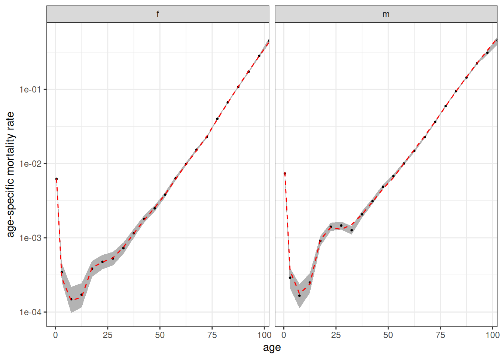

Figure 4: Age-specific mortality rates estimated from simulation. 95%
confidence band shown. Dotted red line shows the input rates.

[Figure 4](#fig-mort-rates-basic-compare) shows the same tight fit for
mortality rates. Note that `calculate_mortality_rates` automatically
added stratification by sex. Both of these functions also take a `by`
argument to stratify by other variables, but at present we haven’t
stratified the input rates by anything else.

## Modeling Union Formation

The previous example used an “on demand” union formation method for
convenience. To better model union formation, I can use a proper
marriage rate schedule. Luckily, the package provides a dataset of US
marriage rates circa 2000.

``` r

usa_2000_marriage
#> # A tibble: 12 × 3
#>    age_start age_end    rate
#>        <int>   <dbl>   <dbl>
#>  1        15      20 0.0156 
#>  2        20      25 0.0845 
#>  3        25      30 0.138  
#>  4        30      35 0.0987 
#>  5        35      40 0.0483 
#>  6        40      45 0.0482 
#>  7        45      50 0.0438 
#>  8        50      55 0.0251 
#>  9        55      60 0.0105 
#> 10        60      65 0.00724
#> 11        65      70 0.00133
#> 12        70     Inf 0.00248
```

These are female marriage rates. Union formation is female-centric.
Women decide when to search for partners and whom to choose. Future
versions of the package may incorporate a proper two-sex model.

We can specify the rates by choosing “rate” as our method in
`set_union_formation` and specifying the marriage rates in the `rates`
argument. However, before we jump straight ahead to that, we need to
also think a little about fertility. Right now fertility rates are not
stratified by `union_type` which means there is no connection between a
women’s hazard of giving birth and her union status. That was fine for
the on demand method because fertility drove union formation. If we
leave it as is now, union formation and fertility will be completely
independent.

To correct for this, I want to stratify the fertility rates by
`union_type`. Luckily (again), the package comes with US fertility rates
in 2000 stratified by union type.

``` r

usa_2000_fertility_union
#> # A tibble: 12 × 4
#>    union_type  age_start age_end   rate
#>    <chr>           <int>   <int>  <dbl>
#>  1 partnered          15      20 0.288 
#>  2 partnered          20      25 0.216 
#>  3 partnered          25      30 0.162 
#>  4 partnered          30      35 0.116 
#>  5 partnered          35      40 0.0481
#>  6 partnered          40      45 0.0096
#>  7 unpartnered        15      20 0.039 
#>  8 unpartnered        20      25 0.0722
#>  9 unpartnered        25      30 0.0585
#> 10 unpartnered        30      35 0.0393
#> 11 unpartnered        35      40 0.0197
#> 12 unpartnered        40      45 0.005

calculate_tfr(usa_2000_fertility_union)
#> # A tibble: 2 × 4
#>   union_type  age_start age_end   tfr
#>   <chr>           <int>   <int> <dbl>
#> 1 partnered          15      45  4.20
#> 2 unpartnered        15      45  1.17
```

Fertility is much higher among partnered women, as we would expect.
Note, I am using a dichotomy between partnered/unpartnered that the
program expects. When cohabitation is also being used, union type can
also be divided into unpartnered/cohab/marriage.

Now I can set up my full model.

``` r

model <- hammel_model() |>
  set_fertility(usa_2000_fertility_union) |>
  set_mortality(usa_2000_mortality) |>
  set_union_formation("rate", rates = usa_2000_marriage) |>
  set_population(pop_initial)
```

The model is set, so lets run it.

``` r

tic()
pop_end <- run_simulation(model, 100, seed = 42)
toc()
#> 1.521 sec elapsed
```

Lets look at population size again.

``` r

pop_end |>
  calculate_population_size(0:100) |>
  ggplot(aes(x = time, y = population)) +
  geom_line()
```

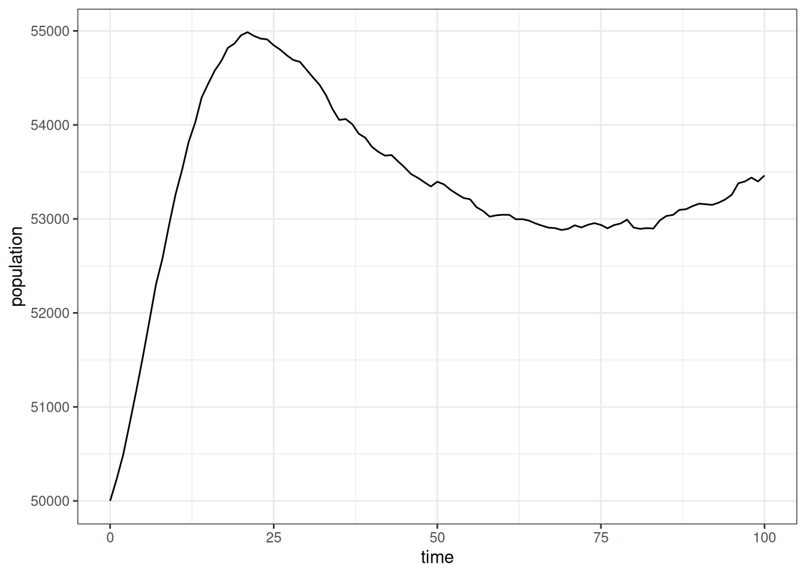

Figure 5: Population size over time in the simulation

In this simulation, the population grew even faster than before and then
declines a bit before leveling off to our slower growth rate. This is a
consequence of starting with an entirely unmarried population. This
exposure to marriage leads to a high initial overall marriage rate
followed by a decline as younger cohorts age into marriage. Those
marriage rates affect the level of exposure to higher partnered
fertility.

To confirm this, we can look at the “crude” marriage rate in five-year
increments by pooling all ages together.

``` r

calculate_marriage_rates(
  pop_end,
  time_breaks = seq(0, 100, 5),
  age_breaks = c(0, Inf)
) |>
  filter(sex == "f") |>
  ggplot(aes(x = time_start + 2.5, y  = rate_marriage)) +
  geom_line() +
  labs(x = "time", y = "crude female marriage rate")
```

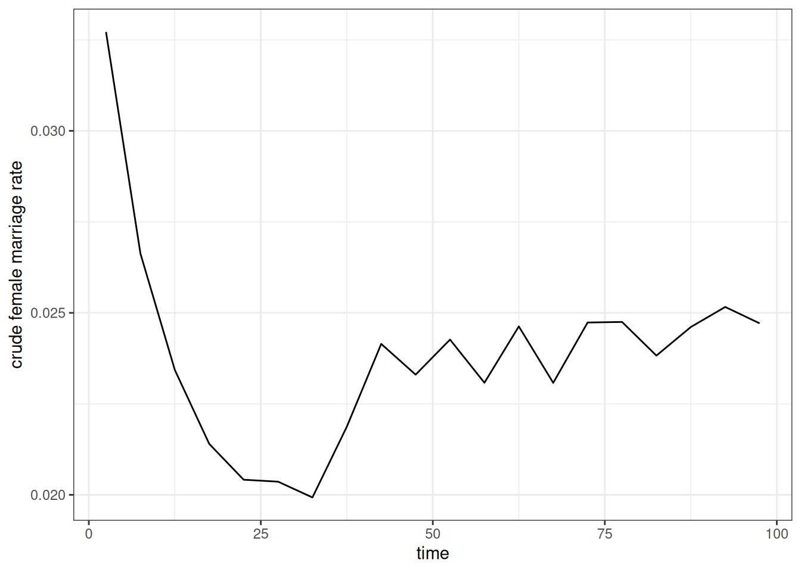

Figure 6: Crude female marriage rates in five year increments across the
simulation

As expected, [Figure 6](#fig-crude-mar-rates) shows the high initial
marriage rate followed by a decline before stabilizing at a somewhat
higher level. We can also do the same with crude birth rates.

``` r

calculate_fertility_rates(
  pop_end,
  time_breaks = seq(0, 100, 5),
  age_breaks = c(0, Inf)
) |>
  ggplot(aes(x = time_start + 2.5, y  = rate_fertility)) +
  geom_line() +
  labs(x = "time", y = "crude birth rate")
```

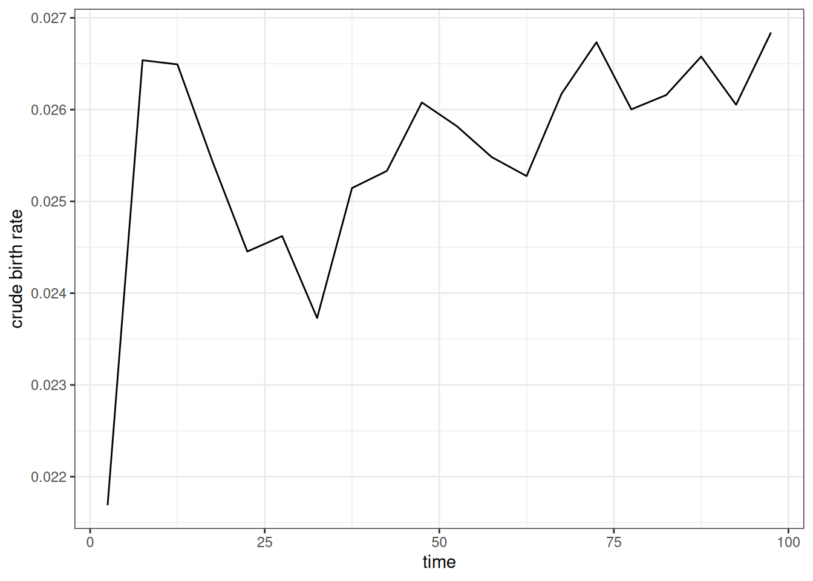

Figure 7: Crude birth rates in five year increments across the
simulation

[Figure 7](#fig-crude-birth-rates) shows a similar pattern to the
previous figure. We see the initial spike in birth rates as many women
enter into unions followed by a decline that corresponds to the decline
in marriage rates. This kind of dynamic is why we often use a “burn in”
period to weed out the effects of the starting population before running
the desired simulation.

When properly stratified by union type, the age-specific fertility rates
should be consistent across the time period regardless of these issues,
except for random noise. [Figure 8](#fig-tfr-compare) shows that this is
true when reporting the period TFR by five year time periods, stratified
by union type.

``` r

calculate_fertility_rates(
  pop_end,
  time_breaks = seq(0, 100, 5),
  age_breaks = seq(15, 45, 5),
  by = "union_type"
) |>
  calculate_tfr() |>
  ggplot(aes(x = time_start + 2.5, y = tfr, color = union_type)) +
  geom_hline(
    data = usa_2000_fertility_union |> calculate_tfr(),
    aes(yintercept = tfr),
    linetype = 2
  ) +
  geom_line() +
  scale_y_continuous(limits = c(0, NA)) +
  labs(x = "time", y = "total fertility rate", color = "union type")
```

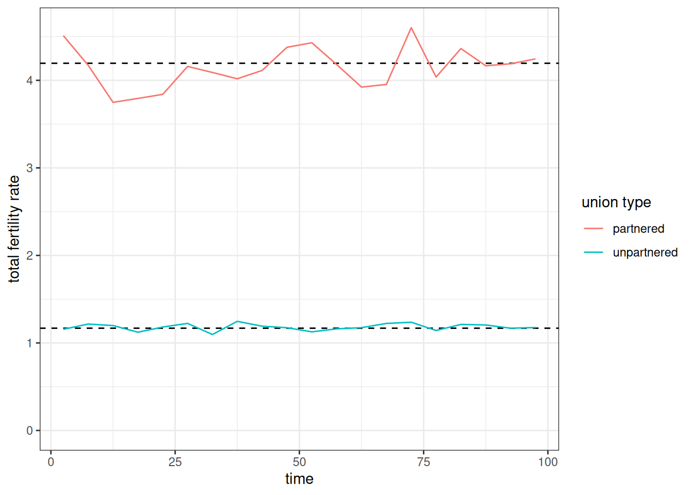

Figure 8: Total fertility rate estimated from period age-specific
fertility rates in five year increments, separated by union type of the
mother. Dotted lines show comparable values for the input rates.

[Figure 9](#fig-age-specific-marriage-rates) show that the age-specific
female marriage rates estimated from the simulation also follow closely
to the input rates.

``` r

calculate_marriage_rates(
  pop_end,
  time_breaks = c(0, 100),
  age_breaks = seq(15, 70, 5),
  conf_level = 0.95
) |>
  filter(sex == "f") |>
  ggplot(aes(x = age_start + 2.5, y = rate_marriage)) +
  geom_ribbon(aes(ymin = conf_low, ymax = conf_high),
              color = NA, fill = "grey70") +
  geom_point(size = 0.5) +
  geom_line(
    data = usa_2000_marriage,
    aes(y = rate),
    linetype = 2,
    color = "red"
  )
```

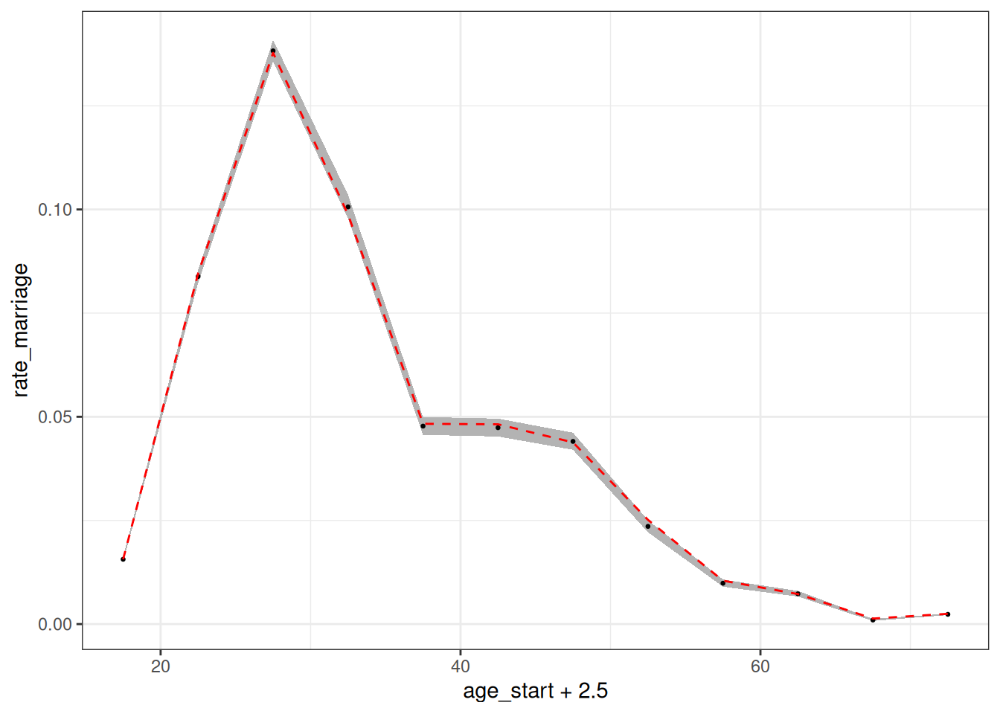

Figure 9: Age-specific female fertility rates estimated from simulation.
95% confidence band shown. Dotted red line shows the input rates.

### Modifying matching characteristics

To this point, I have specified when women will seek out partners, but I
have not specified what kind of partners they will seek out. Are
partners just chosen randomly? To examine this further, lets look at the
distribution of observed age differences between partners from our
simulation. To help with this, we can use the `augment_unions` helper
function to add husband and wife characteristics to the unions data.

``` r

pop_end |>
  augment_unions() |>
  # subtracting birth time of husband from wife gives
  # age husband - age wife
  mutate(age_diff = birth_time_w - birth_time_h) |>
  ggplot(aes(x = age_diff, y = after_stat(density))) +
  geom_histogram(color = NA, fill = "grey70") +
  geom_density(color = "red") +
  geom_vline(xintercept = 0, linetype = 2) +
  labs(x = "husband's age - wife's age")
```

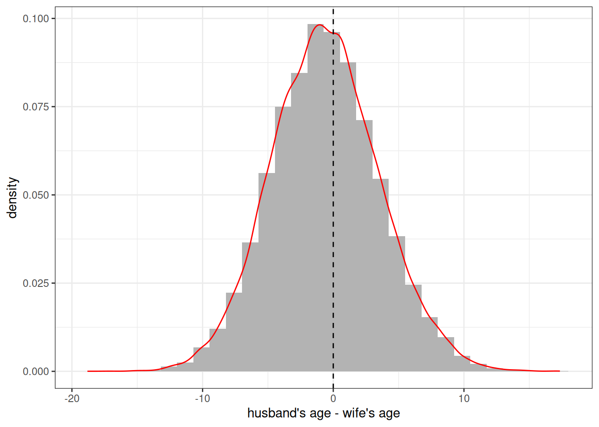

Figure 10: Distribution of age difference between partners from
simulated data

[Figure 10](#fig-age-diff-marriage) reveals that individuals are clearly
not been chosen randomly. There is a strong tendency to marry someone of
a similar age. The overall distribution itself looks (suspiciously) like
a normal distribution centered on zero. This is because we have been
using a default `matching_model` that sets the preferred age difference
at 0.

The decision of how potential partners are matched on the marriage
market is determined by the `matching_model`. The matching model
implicitly uses a conditional logit model in which potential partners
are sampled with weights equal to \\e^{U\_{ij}}\\, where \\U\_{ij}\\ is
the utility of a match between woman \\i\\ and man \\j\\. All eligible
men are considered by a woman when she searches for a partner.
Eligibility is determined by a minimum age characteristics and degree of
relatedness, both of which can be controlled within the model. The
default is to exclude men under 15 and men who are first cousins or
closer in terms of relatedness.

The full
[`matching_model()`](https://aarongullickson.github.io/hammel/reference/matching_model.md)
function allows users full control over \\U\\ through an R style formula
interface with variables for partner age differences and group
membership. However, for most users, the convenience function
[`age_gap_matching_model()`](https://aarongullickson.github.io/hammel/reference/age_gap_matching_model.md)
will be easier to use.

The idea behind the age gap matching model is to fit \\U\\ by a
quadratic equation where \\x\\ is the age difference defined by
husband’s age minus the wife’s age.

\\U = \beta_l x + \beta_q x^2\\

This defines a parabola that will be maximized at \\\beta_l/(-2
\beta_q)\\. This maximum is the preferred age gap between partners.
Instead of entering these \\\beta\\ values directly, the
`age_gap_matching_model` has users input two more intuitive derived
values:

- `preferred_age_gap`: The preferred age gap where \\U\\ is maximized.
- `half_weight_distance`: The number of years of age difference for the
  value of \\U\\ to be halved from the peak. This defines how quickly
  the parabola declines from its peak.

So, I could define a preferred age gap of 3 with a half weight of 10
years as follows:

``` r

match_model <- age_gap_matching_model(3, 5)
```

I can then apply this matching model in my `set_union_formation`
function and re-run the simulation.

``` r

model <- model |>
  set_union_formation(
    "rate",
    rates = usa_2000_marriage,
    matching = match_model,
    min_male_age = 18
  )

pop_end <- run_simulation(model, 100, 42)
```

[Figure 11](#fig-age-diff-match) shows the resulting distribution of
spousal age differences in the new simulation. The peak is now shifted
upward and is close to the three year preferred age gap. The simulated
data are not guaranteed to produce a peak exactly at this preferred age
gap because the decision of who to marry is also conditioned by the
supply of available men by age.

``` r

pop_end |>
  augment_unions() |>
  # subtracting birth time of husband from wife gives
  # age husband - age wife
  mutate(age_diff = birth_time_w - birth_time_h) |>
  ggplot(aes(x = age_diff, y = after_stat(density))) +
  geom_histogram(color = NA, fill = "grey70") +
  geom_density(color = "red") +
  geom_vline(xintercept = 3, linetype = 2) +
  labs(x = "husband's age - wife's age")
```

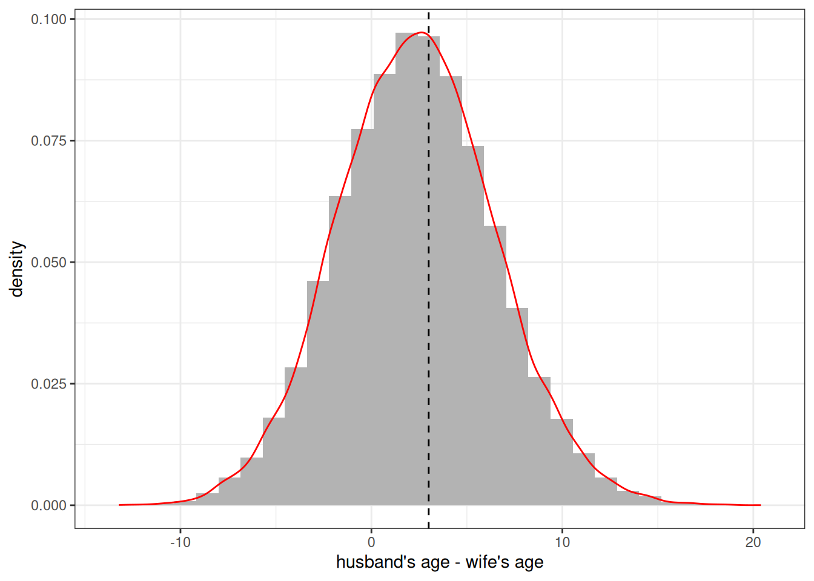

Figure 11: Distribution of age difference between partners from
simulated data. Dotted line shows an age gap of three years, favoring
the husband.

These matching models can also account for preferences that differ by
the specified groups of the partners, but at the moment we have no
groups to include.

## Adding Groups

You can include multiple group designations into a Hammel simulation.
Groups can represent any categorical distinctions between individuals.
Individuals can be allowed to transition between groups with specified
transition rates and inheritance rules can be defined for the assigned
group of newborns. All rate schedules can also be stratified by group
membership. This allows groups to stand in for a variety of dynamic
situations that a user might want to simulate. A few examples:

- Ethnoracial identification with the ability to create “mixed” children
- Regional identification to model internal migration patterns
- Education to model processes of educational attainment

Because you can include multiple group designations at the same time,
there is nothing to stop you from creating simulations that include all
three of these examples at the same time!

### Defining groups

Groups are defined by additional variables in the `persons` tibble of
your starting population. We can add these groups with the `groups`
argument in `generate_uniform_population`. One way to do this is with a
named list of named numeric vectors where each name in the list
corresponds to the desired group name and each name in the vector
corresponds to category names. The values in the vector give relative
sampling weights. For example, I could create a population evenly
divided by two “race” categories of “W” and “B” with the following code.

``` r

pop_race <- generate_uniform_population(
  50000,
  groups = list(race = c(W = 1, B = 1))
)
table(pop_race$persons$race)
#> 
#>     B     W 
#> 25080 24920
```

If using multiple group dimensions, you can also define the joint
distribution with a full tibble. Let me create a population that is
divided by three race groups and four regions.

``` r

region_race_dist <- tribble(
  ~race, ~region, ~weight,
  "W",   "NE",    0.145,
  "W",   "MW",    0.190,
  "W",   "S",     0.257,
  "W",   "W",     0.152,
  "B",   "NE",    0.022,
  "B",   "MW",    0.023,
  "B",   "S",     0.067,
  "B",   "W",     0.019,
  "O",   "NE",    0.021,
  "O",   "MW",    0.014,
  "O",   "S",     0.030,
  "O",   "W",     0.060,
)
# check that this sums to one
sum(region_race_dist$weight)
#> [1] 1

pop_grouped <- generate_uniform_population(50000, groups = region_race_dist)
prop.table(table(pop_grouped$persons$race, pop_grouped$persons$region))
#>    
#>          MW      NE       S       W
#>   B 0.02294 0.02262 0.06536 0.01832
#>   O 0.01436 0.02308 0.03002 0.06018
#>   W 0.18612 0.14676 0.25700 0.15324
```

When I define my simulation, I can now add a `set_groups` function that
allows me to define characteristics for each of my groups. These are
defined by the
[`group()`](https://aarongullickson.github.io/hammel/reference/group.md)
function. This function allows me to define the categories for each
group, whether I want to track group ancestry, and what inheritance rule
to follow for each group. Lets set those groups up now.

``` r

grp_region <- group(
  categories = c("NE", "MW", "S", "W"),
  ancestry = FALSE,
  inheritance = "mother"
)

grp_race <- group(
  categories = c("W", "B", "O"),
  ancestry = TRUE,
  inheritance = group_inheritance(
    "custom",
    fun = function(mother_group, father_group, child_ancestry, ...) {
      known <- 1 - child_ancestry[["unknown"]]
      if (is.na(father_group) || known <= 0 || mother_group == father_group) {
        mother_group
      } else {
        # renormalize ancestry
        w <- child_ancestry[names(child_ancestry) != "unknown"] / known
        sample(names(w), size = 1, prob = w)
      }
    }
  )
)
```

It is not required that you provide category names as these can be
deduced from the input to the model. However, they can be useful to
ensure the desired ordering and to specify any categories that might not
be present in the initial input data but may emerge in the simulation
through custom inheritance rules.

The ancestry argument indicates whether the ancestry of each person by
group category should be tracked within the simulation and returned at
the end. Ancestry is different than group identification and indicates
the share of ancestors that come from each group. In this case, I want
to track it for race, but it would be kind of silly to track it for
regional migration.

The inheritance argument defines how children are assigned a group
category. For region, I can just assign one of the existing methods by
name. I choose “mother” so that each newborn is given their mother’s
region. For race, I use a custom R function to assign inheritance. This
custom function assigns the mother’s race when the mother and father
have the same racial identification. When they do not, I sample a race
category weighted by the ancestry share of each group for that child.
This is similar to the canned “ancestry” method but only samples when
parents belong to different groups and can select a racial group that
neither partner belongs to.

### Determining exogamy

I am almost ready to run my simulation, but I want to make a couple of
other changes. First, I also want to define how common group exogamy is
across both group dimensions. For region, I want to disallow any exogamy
across regions, because regions will serve as the local marriage market.
For racial groups, I want to make racial exogamy rarer than racial
endogamy. I can do both of these things by adding a `group_exogamy`
argument to my matching model.

``` r

match_model_grp <- age_gap_matching_model(
  preferred_age_gap = 3,
  half_weight_distance = 5,
  group_exogamy = list(
    race = c("W:B" = -4, "W:O" = -2, "B:O" = -3),
    region = NA
  )
)
```

The `group_exogamy` argument accepts a named list where names correspond
to my groups. I use NA for `region` to disallow any exogamy. For race, I
use a named vector giving all the possible symmetric pairings of my
racial groups. For each case, I provide a value. This value is added to
the \\U\\ for any union that crosses those group boundaries. These
values roughly correspond to half the log-odds ratio from the
cross-tabulation of husband’s by wife’s race. So, if the desired
log-odds ratio between groups “W” and “B” is -8, I use a value of -4.
Negative values reduce the likelihood of exogamy relative to endogamy.

### Using transition rates

I also want to consider whether groups can transition into different
categories. For race, I will not allow transitions between groups.
However, I very much want to allow transitions between regions to
simulate internal migration. Luckily, the package has included data on
the estimated migration rates between these regions in the year 2000.

``` r

usa_2000_migration
#> # A tibble: 132 × 5
#>    origin destination age_start age_end     rate
#>    <chr>  <chr>           <int>   <dbl>    <dbl>
#>  1 MW     NE                  0       5 0.00144 
#>  2 MW     NE                  5      10 0.00119 
#>  3 MW     NE                 10      20 0.00112 
#>  4 MW     NE                 20      25 0.00224 
#>  5 MW     NE                 25      30 0.00216 
#>  6 MW     NE                 30      35 0.00144 
#>  7 MW     NE                 35      45 0.00108 
#>  8 MW     NE                 45      55 0.000685
#>  9 MW     NE                 55      65 0.000685
#> 10 MW     NE                 65      85 0.000397
#> # ℹ 122 more rows
```

Note that all transition rate schedules must include an `origin` and a
`destination` column to indicate directional transitions. Rates are
defined by person-years spent in the origin category.

### Stratifying rates by group

I will add one more change to my inputs before building the model. I
want to allow fertility to vary by race and region. I an use the
`stratify_rates` helper function to quickly stratify rates using a
proportional hazards approach.

``` r

fertility_rates_grp <- bind_rows(
  usa_2000_fertility_union |>
    filter(union_type == "partnered") |>
    stratify_rates(list(race = c(W = 1, B = 1.05, O = 1.05))),
  usa_2000_fertility_union |>
    filter(union_type == "unpartnered") |>
    stratify_rates(list(race = c(W = 1, B = 1.2, O = 1.05)))
) |>
  stratify_rates(list(region = c(NE = 1, MW = 1.05, S = 1.1, W = 1)))

calculate_tfr(fertility_rates_grp)
#> # A tibble: 24 × 6
#>    union_type  race  region age_start age_end   tfr
#>    <chr>       <chr> <chr>      <int>   <int> <dbl>
#>  1 partnered   W     NE            15      45  4.20
#>  2 partnered   B     NE            15      45  4.40
#>  3 partnered   O     NE            15      45  4.40
#>  4 unpartnered W     NE            15      45  1.17
#>  5 unpartnered B     NE            15      45  1.40
#>  6 unpartnered O     NE            15      45  1.23
#>  7 partnered   W     MW            15      45  4.40
#>  8 partnered   B     MW            15      45  4.62
#>  9 partnered   O     MW            15      45  4.62
#> 10 unpartnered W     MW            15      45  1.23
#> # ℹ 14 more rows
```

I split the rates by partnership status to apply different proportional
hazards by race and partnership status. For region, I apply the same
proportional hazards across union type.

### Put it all together

Now we are ready to build the full model.

``` r

model <- hammel_model() |>
  set_population(pop_grouped) |>
  set_fertility(fertility_rates_grp) |>
  set_mortality(usa_2000_mortality) |>
  set_union_formation(
    "rate",
    rates = usa_2000_marriage,
    matching = match_model_grp
  ) |>
  set_groups(race = grp_race, region = grp_region) |>
  set_group_transition(
    usa_2000_migration,
    group = "region",
    household = household(age_independence = 18)
  )
```

One final thing to note about this model is that for the group
transition, I am defining households, so that migration transitions
happen to households rather than individuals. A person’s household is
their current partner (married or cohabiting) and the dependents
attached to either of them. Children under the `age_independence` follow
the mother, if alive, and otherwise the father.

``` r

tic()
pop_end <- run_simulation(model, 100, 42)
toc()
#> 45.203 sec elapsed
```

This simulation took quite a bit longer to run. The reason for this is
the use of a custom R function, because R processing will generally be
slower than the underlying C++ used for most of the simulation.

Lets look at how race and region changed over time. The `by` argument
will allow us to stratify results in all of the `calculate` helper
functions.

``` r

calculate_population_size(pop_end, seq(0, 100, 5), by = c("race", "region")) |>
  group_by(time, region) |>
  mutate(prop = population / sum(population)) |>
  ggplot(aes(x = time, y = prop, group = race, color = race)) +
  geom_line() +
  facet_wrap(~region) +
  labs(x = "year", y = "share of population")
```

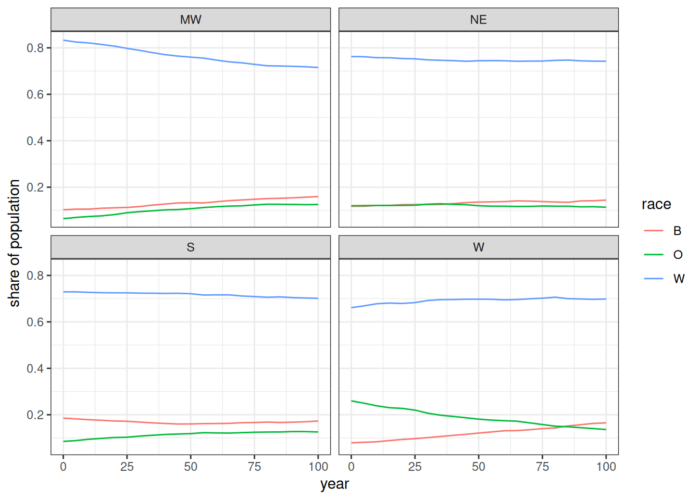

Figure 12: Share of each race in the population by region over the
simulation run time

[Figure 12](#fig-pop-by-race-region), shows the changing distributions
of race within each region. The biggest divergence is in the W region
where the O group declines as it becomes distributed more evenly across
the other regions over time. The W region is also the only region where
the W race group did not decline.

I can use the `augment_unions` function to get the race of husband and
wife and use this to calculate the log-odds ratio of each interracial
pairing.

``` r

expected <- tibble(
  pair = c("W:B", "W:O", "B:O"),
  expected = c(-4, -2, -3) * 2
)

pop_end |>
  augment_unions() |>
  count(race_w, race_h) |>
  pivot_wider(names_from = c(race_w, race_h), values_from = n) |>
  mutate(
    log_odds_W_B = log(W_B) + log(B_W) - log(W_W) - log(B_B),
    se_W_B = sqrt(1 / W_B + 1 / B_W + 1 / W_W + 1 / B_B),
    log_odds_W_O = log(W_O) + log(O_W) - log(W_W) - log(O_O),
    se_W_O = sqrt(1 / W_O + 1 / O_W + 1 / W_W + 1 / O_O),
    log_odds_B_O = log(B_O) + log(O_B) - log(B_B) - log(O_O),
    se_B_O = sqrt(1 / B_O + 1 / O_B + 1 / B_B + 1 / O_O)
  ) |>
  select(starts_with("log_odds"), starts_with("se_")) |>
  pivot_longer(
    everything(),
    names_to = c(".value", "pair"),
    names_pattern = "(log_odds|se)_(.*)"
  ) |>
  mutate(pair = str_replace(pair, "_", ":")) |>
  left_join(expected, by = "pair") |>
  ggplot(aes(x = pair, y = log_odds)) +
  geom_point() +
  geom_linerange(
    aes(
      ymin = log_odds - 1.96 * se,
      ymax = log_odds + 1.96 * se
    )
  ) +
  geom_point(aes(y = expected), color = "red", alpha = 0.7) +
  coord_flip() +
  labs(x = "interracial pairing", y = "log-odds")
```

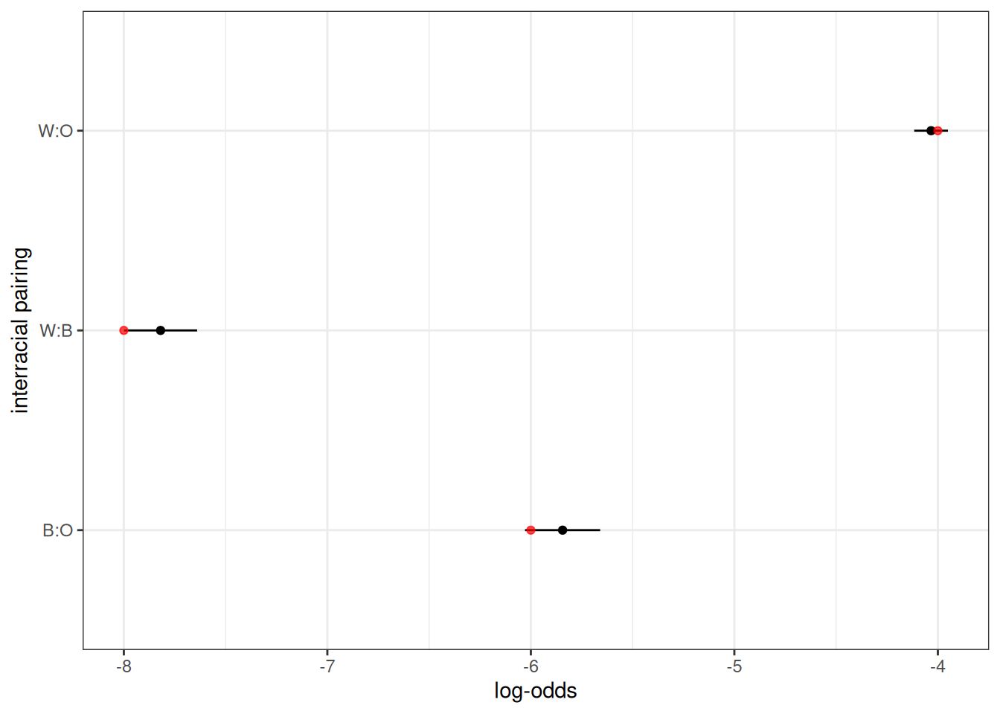

Figure 13: Observed log odds ratio of interracial marriage by pairing
with 95% confidence interval. Red dot shows expected value from input.

[Figure 13](#fig-odds-ratio) shows the observed log odds ratio of a
given interracial pairing in comparison to that expected from the input
values (twice the provided value). They closely align.

I can also show that no marriages occurred across regions.

``` r

pop_end |>
  augment_unions() |>
  count(region_w, region_h)
#> # A tibble: 4 × 3
#>   region_w region_h     n
#>   <chr>    <chr>    <int>
#> 1 MW       MW       10021
#> 2 NE       NE        6152
#> 3 S        S        15888
#> 4 W        W         9053
```

Finally, I can get the observed migration rates using
`calculate_transition_rates`.

``` r

calculate_transition_rates(
  pop_end,
  group = "region",
  time_breaks = c(0, 100),
  age_breaks = c(seq(0, 35, 5), seq(45, 85, 10)),
  conf_level = 0.95
) |>
  ggplot(aes(x = age_start, y = rate_transition)) +
  geom_ribbon(aes(ymin = conf_low, ymax = conf_high),
              color = NA, fill = "grey60") +
  geom_point(size = 0.5) +
  geom_line(data = usa_2000_migration, aes(y = rate),
            linetype = 2, color = "red") +
  geom_vline(xintercept = 18, linetype = 2) +
  facet_grid(origin ~ destination) +
  labs(x = "age", y = "migration rate")
```

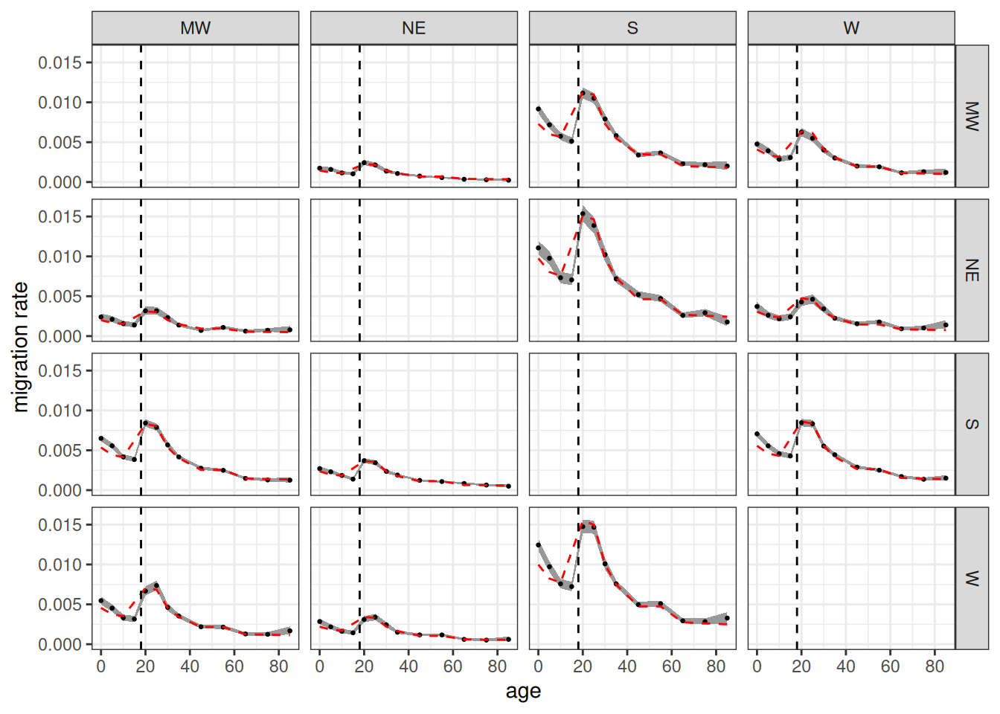

Figure 14: Age-specific migration rates by origin and destination region
with 95% confidence band. Red dotted line shows input rates.

[Figure 14](#fig-migration-rates) shows the age-specific migration rates
from the simulation in comparison to the input rates. Because dependents
travel with their household, not independently, we don’t expect the
values to match under age 18. Beyond that age range, the values fit
closely to the input rates.

## Going Further

Other vignettes provided here go into more detail on other features of
Hammel.

- The [Demographic
  Transition](https://aarongullickson.github.io/hammel/articles/demographic_transition.md)
  vignette shows how to vary rates by time within the same simulation
  and how to extract kinship information from the simulation output.
- The [Second Demographic
  Transition](https://aarongullickson.github.io/hammel/articles/second_demog_transition.md)
  vignette shows how to add union dissolution, remarriage, and
  cohabitation into the simulation model.
- The [Multigroup
  Intermarriage](https://aarongullickson.github.io/hammel/articles/multigroup_intemar.md)
  vignette shows how to vary inheritance and matching models by time
  within the same simulation and how to develop custom inheritance
  models.

Hammel is in active development so if you have questions or would like
to see a new feature implemented, feel free to open an
[issue](https://github.com/AaronGullickson/hammel/issues).
