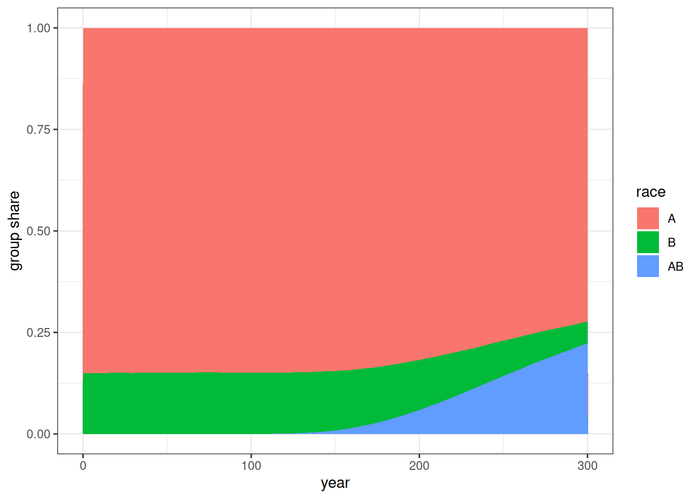
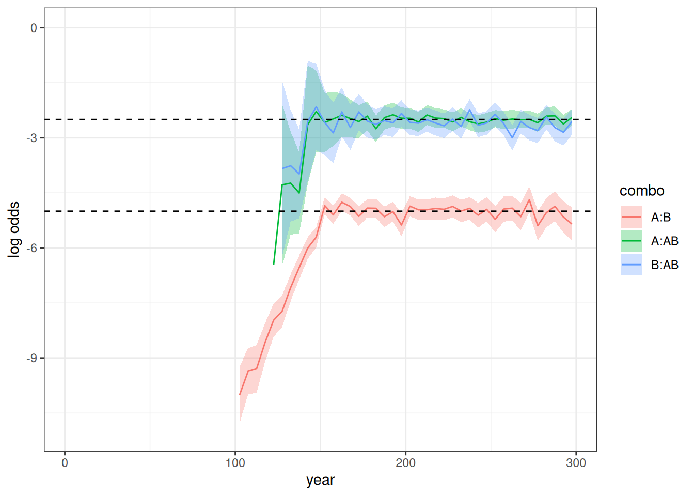
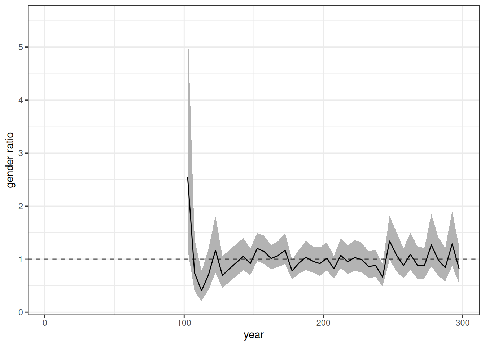
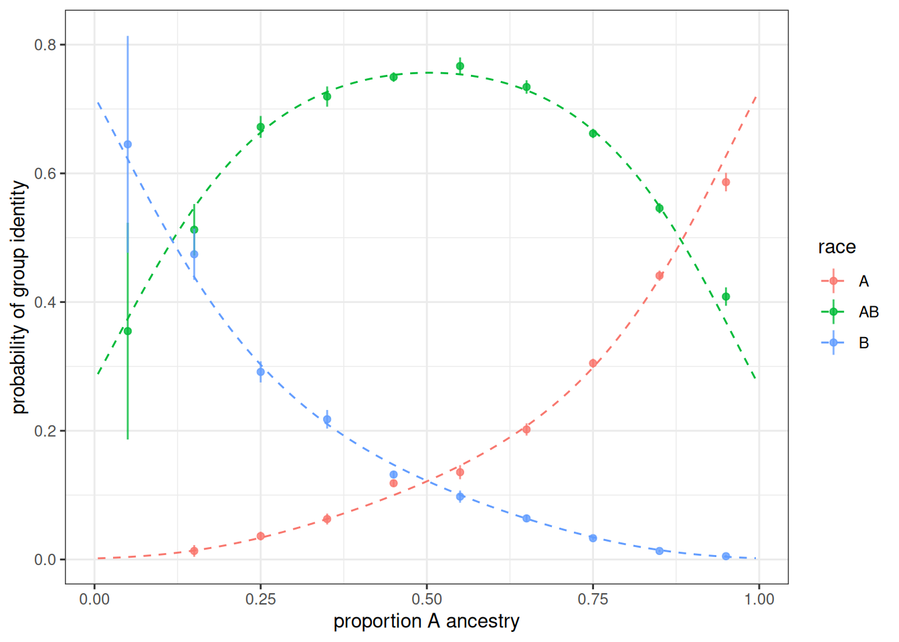
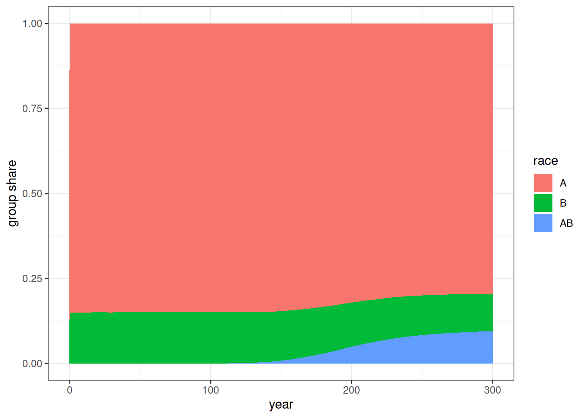

# Multigroup Simulation with Custom Inheritance

``` r

library(hammel)
library(dplyr)
library(tidyr)
library(ggplot2)
library(gt)
library(stringr)
```

Our goal is replication of one of the simulations that Gullickson and
Saperstein (2026) ran using SOCSIM. These simulations use an abstract
two-group population (groups A and B) where group exogamy is allowed to
grow over time and different rules are applied about how children with
parents beloning to different groups are assigned a group membership.
The inheritance rules allow for the emergence of an identified “mixed”
AB population even as some individuals with mixed group ancestry
re-identify with a single group.

Specifically, we will reproduce the simulation with an uneven starting
group size, intermarriage trends that plateau after 50 years, and a
“high resilient” inheritance pattern. Simulations will run for 200
years, after an initial 100 year burn-in period where no intermarriage
is possible.

## Gather Inputs

We will use static fertility and mortality rates from the USA in 2000.
Union formation will use the “on demand” model, so we do not need to
specify rates of marriage.

We also need to set up models of inheritance and group exogamy that can
change over time. We can do this by setting up “list tibbles” with
`time_start` and `time_end` columns to handle change over time.

For this simulation, we will include the burn-in period as part of the
same simulation. So, for the first 100 years of the simulation, we will
disallow group exogamy. We will then start with a very low group exogamy
value of -5. The group exogamy value should produce a log-odds ratio of
intermarriage double that size. So, a starting value of -5 corresponds
to a log odds ratio of intermarriage of -10, which is similar to that
observed historically between White and Black populations in the USA.

We then allow the absolute value of the group exogamy parameter to
decline by 0.25 every five years until it stops declining after 50 years
at a value of -2.5. It then holds constant at -2.5 for the remainder of
the simulation.

We can set up a specific matching model for a given time period with the
needed parameters by using `age_gap_matching_model` where we also apply
a preferred two-year age gap between husbands and wives. To create time
variation, we put all of our models into a list and then add it as a
column of a tibble that contains the `time_start` and `time_end`
columns.

``` r

m <- list(age_gap_matching_model(2, 5, group_exogamy = NA))
lodds <- -5
for (i in 1:11) {
  m[[length(m) + 1L]] <- age_gap_matching_model(
    2, 5,
    group_exogamy = c("A:B" = lodds, "A:AB" = lodds / 2, "B:AB" = lodds / 2)
  )
  lodds <- lodds + 0.25
}

matching_models <- tibble(
  time_start = c(0, seq(100, 150, 5)),
  time_end   = c(100, seq(105, 150, 5), 300),
  model      = m
)
```

We can use the same approach to vary the inheritance models. In this
case, we will just switch from a “random_parent” pre-defined model in
the burn-in period to a custom inheritance model for the remainder of
the simulation.

The custom inheritance approach here uses the same approach as
Gullickson and Saperstein (2026). We allow for the possibility for
children to identify as A, B, or AB. The probability is governed by a
multinomial logit model with a single predictor variable given by the
proportion of A ancestry that the child has. In the high resilient model
we are using here, the probability of AB identification is maximized at
around 70% when the child has 50% of their ancestry from either group.
As ancestry moves in the direction favoring one group, the AB
probability declines and the probability of identifying with the group
with more shared ancestry increases.

``` r

inheritance_models <- tibble(
  time_start = c(0, 100),
  time_end   = c(100, Inf),
  model      = list(
    group_inheritance("random_parent"),
    group_inheritance(
      "custom",
      fun = function(child_ancestry, mother_group, father_group, ...) {
        # Same identity or missing father: follow mother
        if (is.na(father_group) || mother_group == father_group) {
          return(mother_group)
        }

        # Entirely unknown ancestry: follow mother
        known <- 1 - child_ancestry[["unknown"]]
        if (known <= 0) return(mother_group)

        # if we are here then assign as a function of group A ancestry
        prop_A <- child_ancestry[["A"]] / known

        logits <- c(
          A  = -5.138 + 11.88 * prop_A - 15.3 * prop_A^2 + 9.553 * prop_A^3,
          B  = 0.949 - 9.39 * prop_A + 11.935 * prop_A^2 - 8.483 * prop_A^3,
          AB = 0
        )
        weights <- exp(logits - max(logits))

        sample(names(weights), size = 1, prob = weights)
      }
    )
  )
)
```

## Run Simulation

We will use uneven starting groups of A (85%) and B (15%).

``` r

pop <- generate_uniform_population(
  200000,
  end_time = 0,
  groups = list(race = c("A" = 0.85, "B" = 0.15))
)
```

In this case, the 100 year run-in to produce a stable population is
included already in the input objects. So, we just need to run the
simulation for 300 years to produce the desired result. Note that
because I set `end_time = 0` in the baseline population, all of our time
increments count up from zero.

``` r

model <- hammel_model() |>
  set_population(pop) |>
  set_mortality(usa_2000_mortality) |>
  set_fertility(usa_2000_fertility) |>
  set_groups(race = group(categories = c("A", "B", "AB"), ancestry = TRUE,
                          inheritance = inheritance_models)) |>
  set_union_formation("on_demand", matching = matching_models)

runtime <- system.time(pop_final <- run_simulation(model, 300, 42))
```

The simulation takes 30.971 seconds to run.

## Analyze the Simulation Results

``` r

calculate_population_size(pop_final, seq(0, 300, 5), by = "race") |>
  group_by(time) |>
  mutate(prop = population / sum(population)) |>
  ungroup() |>
  mutate(race = factor(race, levels = c("A", "B", "AB"))) |>
  ggplot(aes(x = time, y = prop, fill = race)) +
  geom_area() +
  labs(x = "year", y = "group share")
```



Figure 1: Group share across time in simulation

[Figure 1](#fig-pop-share-groups) shows the group shares over time. The
AB group emerges after 100 years and grows to a larger share of the
population over time.

``` r

crosstabs <- pop_final |>
  augment_unions() |>
  mutate(time_mid = floor(start_time / 5) * 5 + 2.5) |>
  count(time_mid, race_w, race_h) |>
  pivot_wider(names_from = c(race_w, race_h), values_from = n) |>
  mutate(
    log_odds_A_B = log(A_B) + log(B_A) - log(A_A) - log(B_B),
    se_A_B = sqrt(1 / A_B + 1 / B_A + 1 / A_A + 1 / B_B),
    log_odds_A_AB = log(A_AB) + log(AB_A) - log(A_A) - log(AB_AB),
    se_A_AB = sqrt(1 / A_AB + 1 / B_AB + 1 / A_A + 1 / AB_AB),
    log_odds_B_AB = log(B_AB) + log(AB_B) - log(B_B) - log(AB_AB),
    se_B_AB = sqrt(1 / B_AB + 1 / AB_B + 1 / B_B + 1 / AB_AB)
  )

crosstabs |>
  select(time_mid, starts_with("log_odds"), starts_with("se_")) |>
  pivot_longer(
    cols = -time_mid,
    names_to = c(".value", "combo"),
    names_pattern = "(log_odds|se)_(.*)"
  ) |>
  mutate(
    combo = str_replace(combo, "_", ":"),
    combo = factor(combo, levels = c("A:B", "A:AB", "B:AB"))
  ) |>
  ggplot(aes(x = time_mid, y = log_odds, color = combo, group = combo)) +
  geom_ribbon(
    aes(ymin = log_odds - 1.96 * se, ymax = log_odds + 1.96 * se, fill = combo),
    color = NA,
    alpha = 0.3
  ) +
  geom_line() +
  geom_hline(yintercept = c(-5, -2.5), linetype = 2) +
  scale_y_continuous(limits = c(0, -11)) +
  labs(x = "year", y = "log odds")
```



Figure 2: Log-odds ratio over time (5 year intervals) between three
groups. 95% confidence bands shown. Dotted lines show expected plateaus
for the A:B group and A:AB and B:AB groups.

[Figure 2](#fig-log-odds) shows the log odds ratios over time for the
three combinations. No log odds ratios show for the first 100 years as
expected because intermarriage was not allowed. When the log odds are
very low or the groups are still very small (as for the AB group between
100 and 150 years), the log odds ratio can sometimes not be estimated
due to zero values in one of the cells. Thus, log odds ratios don’t
appear for combos involving the AB group for some time after year 100
because the group is so small and the first members of it must grow old
enough to be able to partner up. The A:B log odds ratio behaves exactly
as expected by the input exogamy ratios, starting at roughly -10 and
plateauing at -5. The A:AB and B:AB log odds ratios are about half that
throughout and stabilize at -2.5, as expected.

``` r

ratio <- pop_final |>
  augment_unions() |>
  mutate(time_mid = floor(start_time / 5) * 5 + 2.5) |>
  count(time_mid, race_w, race_h) |>
  pivot_wider(names_from = c(race_w, race_h), values_from = n) |>
  mutate(
    ratio_A_B = A_B / B_A,
    se_log = sqrt(1 / A_B + 1 / B_A),
    conf_lower = ratio_A_B * exp(-1.96 * se_log),
    conf_upper = ratio_A_B * exp(1.96 * se_log)
  )

ratio |>
  ggplot(aes(x = time_mid, y = ratio_A_B)) +
  geom_ribbon(
    aes(ymin = conf_lower, ymax = conf_upper),
    color = NA,
    fill = "grey70"
  ) +
  geom_line() +
  geom_hline(yintercept = 1, linetype = 2) +
  labs(x = "year", y = "gender ratio")
```



Figure 3: Gender ratio over time (5 year intervals) within A:B
marriages. 95% confidence bands shown. Dotted lines show the expected
ratio of 1.

[Figure 3](#fig-gender-ratio) shows the gender ratio over time which
should be held at roughly one throughout the simulation. This is
generally true, except for the early period where the low rates lead to
high volatility across samples.

``` r

temp <- tibble(
  prop_A = seq(0.005, 0.995, 0.005),
  logit_A = -5.138 + 11.88 * prop_A - 15.3 * prop_A^2 + 9.553 * prop_A^3,
  logit_B = 0.949 - 9.39 * prop_A + 11.935 * prop_A^2 - 8.483 * prop_A^3,
  denom = exp(logit_A) + exp(logit_B) + exp(0),
  prob_A = exp(logit_A) / denom,
  prob_B = exp(logit_B) / denom,
  prob_AB = exp(0) / denom
) |>
  select(prop_A, starts_with("prob_")) |>
  pivot_longer(
    cols = starts_with("prob_"),
    names_prefix = "prob_",
    names_to = "race",
    values_to = "prop"
  ) |>
  rename(prop_a_group = prop_A)

pop_final$persons |>
  filter(birth_time >= 100) |>
  left_join(select(pop_final$ancestry$race, person_id, A), by = "person_id") |>
  left_join(
    pop_final$persons |>
      select(person_id, race) |>
      rename(father_id = person_id, race_father = race),
    by = "father_id"
  ) |>
  left_join(
    pop_final$persons |>
      select(person_id, race) |>
      rename(mother_id = person_id, race_mother = race),
    by = "mother_id"
  ) |>
  filter(!is.na(race_father) & !is.na(race_mother) &
           race_father != race_mother) |>
  mutate(
    prop_a_group = cut(
      A,
      breaks = seq(0, 1, 0.1),
      labels = FALSE,
      include.lowest = TRUE
    ) * 0.1 - 0.05
  ) |>
  group_by(prop_a_group, race) |>
  summarize(n = n()) |>
  mutate(prop = n / sum(n), se = sqrt(prop * (1 - prop) / sum(n))) |>
  ungroup() |>
  ggplot(aes(x = prop_a_group, y = prop, group = race, color = race)) +
  geom_line(data = temp, linetype = 2) +
  geom_point(alpha = 0.8) +
  geom_linerange(aes(ymin = prop - 1.96 * se, ymax = prop + 1.96 * se),
                 alpha = 0.8) +
  labs(x = "proportion A ancestry", y = "probability of group identity")
```



Figure 4: Probability of group assignment as a function of proportion A
ancestry among births to parents belonging to different groups for all
births in a single simulation. Proportion A ancestry is plotted in 10
percent bins by the midpoint of the bin. 95% confidence intervals shown.
The dotted line shows the expected probability from the inheritance
model.

[Figure 4](#fig-custom-inheritance-prob) shows the observed probability
of being assigned to a given group as a function of share of A ancestry
for births to parents from different groups. The dotted line shows the
expected probabilities from the model. The results line up closely to
expectation and most 95% confidence intervals contain the expected
value.

### Add transition rates

To test time-varying transition rates, I add transition rates to the
simulation where AB individuals have an equal rate of transitioning back
to A or B with equal probability upon becoming adults. We will double
that transition rate halfway through the latter 200 years of the
simulation.

``` r

trans_rates <- tribble(
  ~time_start, ~time_end, ~origin, ~destination, ~age_start, ~age_end, ~rate,
  0,           100,       "AB",           "B",         15,         20,   0.00,
  0,           100,       "AB",           "A",         15,         20,   0.00,
  100,         200,       "AB",           "B",         15,         20,   0.02,
  100,         200,       "AB",           "A",         15,         20,   0.02,
  200,         300,       "AB",           "B",         15,         20,   0.04,
  200,         300,       "AB",           "A",         15,         20,   0.04
)
```

``` r

model <- hammel_model() |>
  set_population(pop) |>
  set_mortality(usa_2000_mortality) |>
  set_fertility(usa_2000_fertility) |>
  set_groups(race = group(categories = c("A", "B", "AB"), ancestry = TRUE,
                          inheritance = inheritance_models)) |>
  set_union_formation("on_demand", matching = matching_models) |>
  set_group_transition(trans_rates)

runtime <- system.time(pop_final <- run_simulation(model, 300, 42))
```

``` r

calculate_population_size(pop_final, seq(0, 300, 5), by = "race") |>
  group_by(time) |>
  mutate(prop = population / sum(population)) |>
  ungroup() |>
  mutate(race = factor(race, levels = c("A", "B", "AB"))) |>
  ggplot(aes(x = time, y = prop, fill = race)) +
  geom_area() +
  labs(x = "year", y = "group share")
```



Figure 5: Group share across time in simulation with transition rates

[Figure 5](#fig-pop-share-groups-trans) shows the group share over time
in the simulation with these transition rates. As expected, the growth
of the AB group is slower than the previous simulation due to some
transitions back into single group categories.

``` r

temp <- calculate_transition_rates(
  pop_final,
  time_breaks = c(0, 100, 200, 300),
  age_breaks = c(15, 20),
  conf_level = 0.95
) |>
  filter(origin == "AB", age_start == 15) |>
  select(time_start, time_end, age_start, age_end, origin, destination,
         rate_transition, conf_low, conf_high) |>
  left_join(trans_rates)

temp |>
  gt() |>
  cols_label(
    time_start ~ "Starting time",
    time_end  ~ "Ending time",
    age_start ~ "Age start",
    age_end ~ "Age end",
    origin ~ "Origin",
    destination ~ "Destination",
    rate_transition ~ "Observed rate",
    conf_low ~ "Low",
    conf_high ~ "High",
    rate ~ "Input rate"
  ) |>
  tab_spanner(starts_with("conf_"), label = "95% Confidence interval") |>
  fmt_number(c(rate_transition, conf_low, conf_high), decimals = 4)
```

[TABLE]

Table 1: Estimated transition rates from simulation with 95% confidence
intervals. Input rates are shown for reference.

[Table 1](#tbl-transition-rates) shows that the estimated transition
rates are very close to the expected input transition rates.

## References

Gullickson, Aaron, and Aliya Saperstein. 2026. “The Dynamics of
Population Mixing: A Simulation Approach.” Population Association of
America, St. Louis, MO, May 8.
