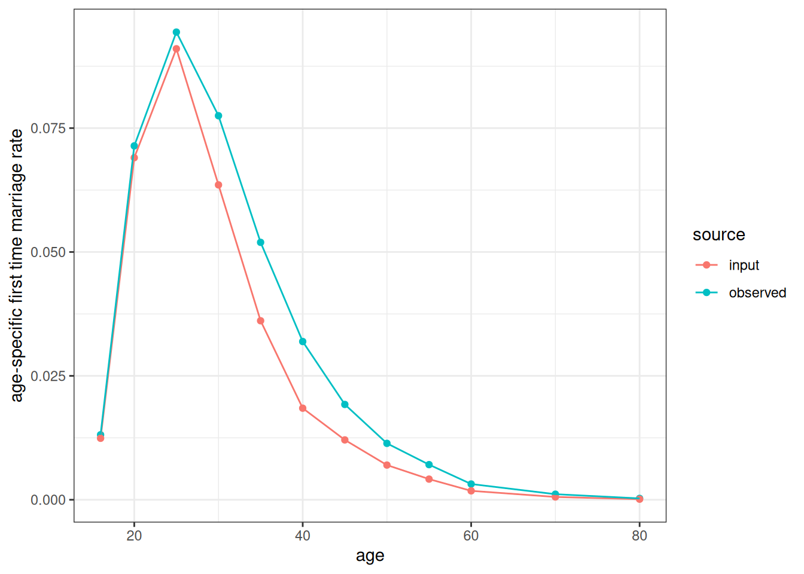
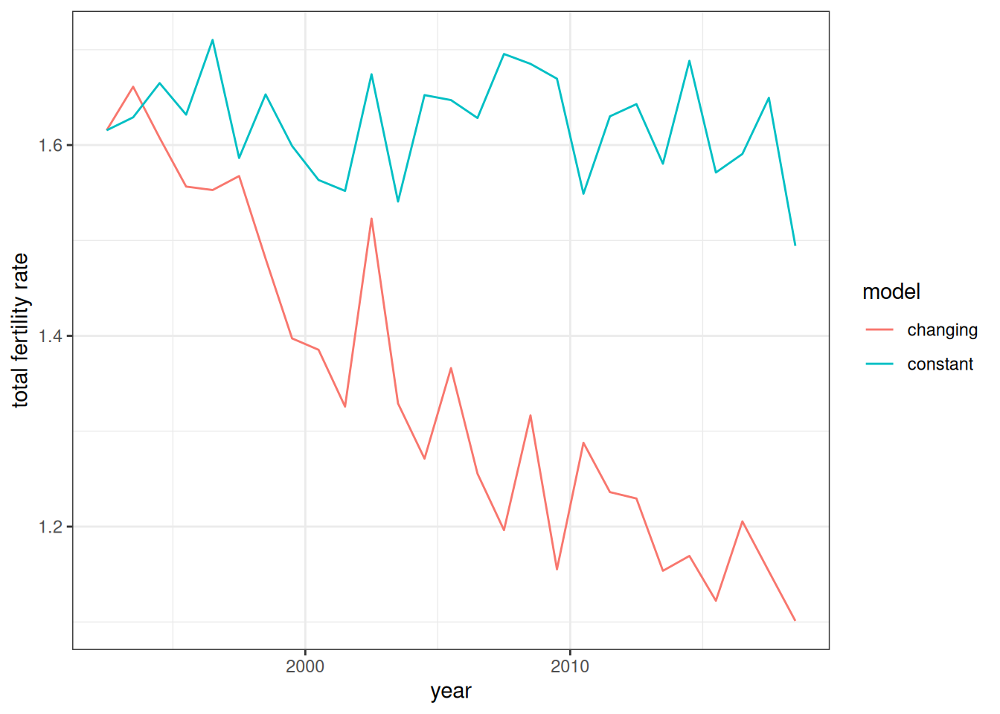
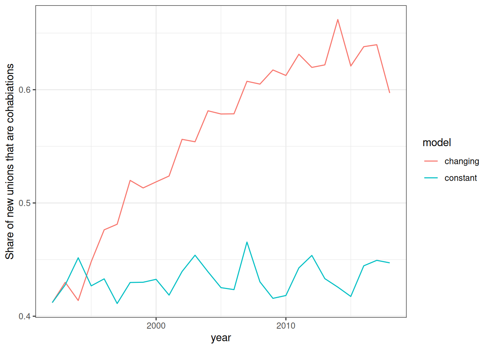
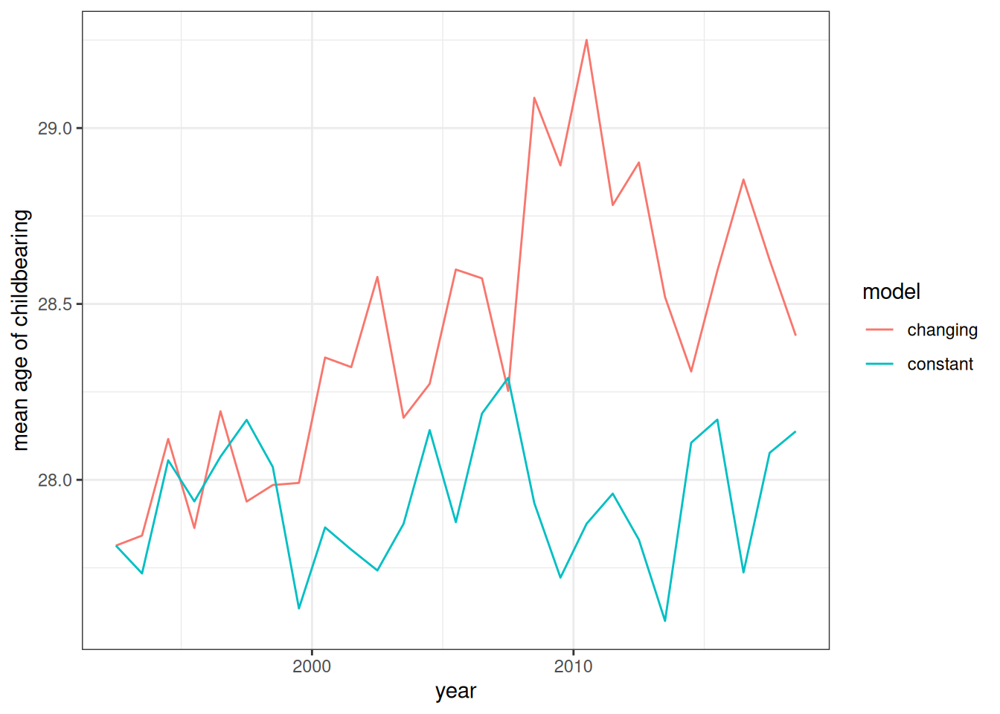
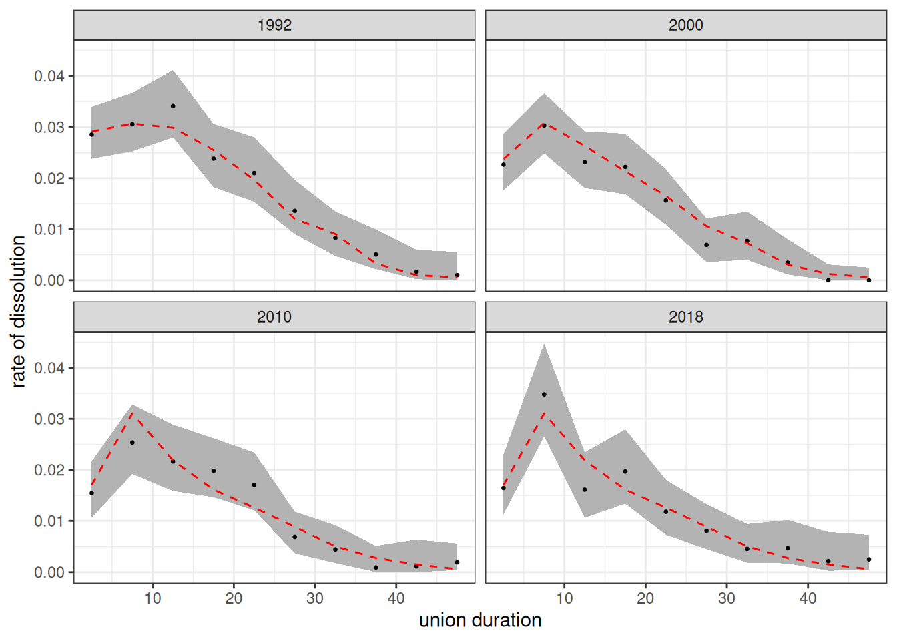
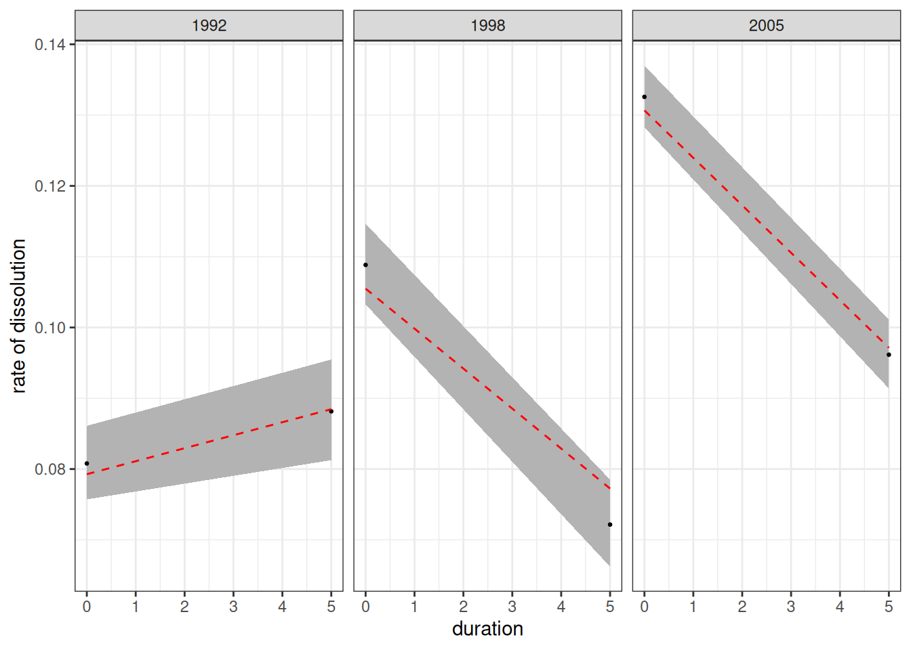
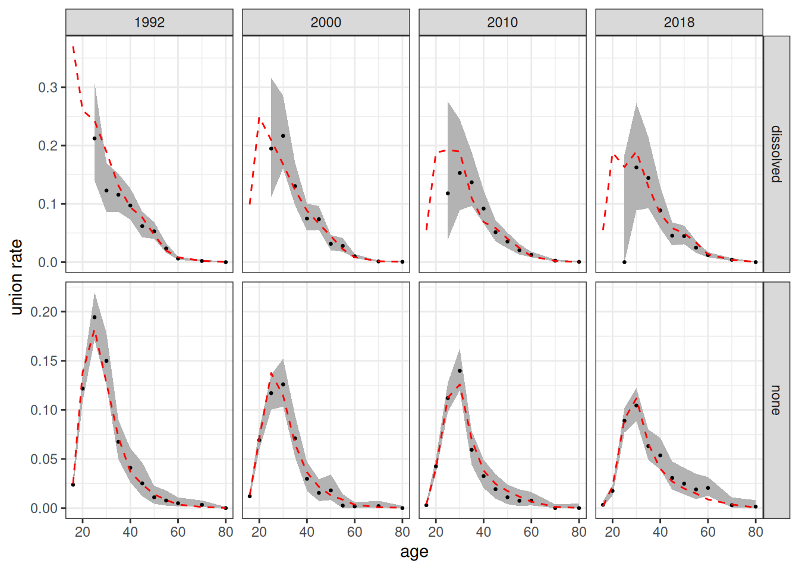
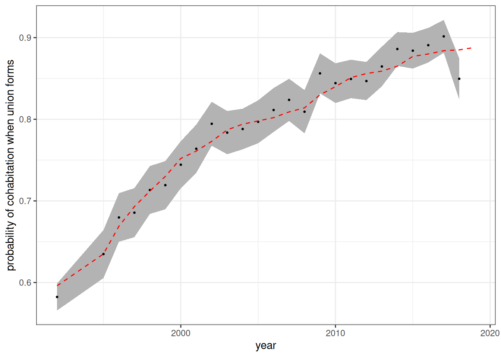

# Simulating the Second Demographic Transition

``` r

library(hammel)
library(dplyr)
library(tidyr)
library(ggplot2)
```

The “second demographic transition” is a term used to describe several
features of the demographic profiles of advanced industrial countries
that have produced complicated family structures and low fertility, such
as rising rates of cohabitation, later age at marriage, fertility delay,
and increasing marriage dissolution.

Even if age-specific fertility rates were to remain constant within
union types (e.g. unpartnered, cohabitation, and marriage), we would
expect overall fertility rates to fall because women spend less time in
a partnered status during the most reproductive period of life.

To show this effect on overall fertility, we will set up a simulation
that holds fertility rates within union type constant, but increases the
following:

- frequency of cohabitation
- age profile of union formation rates
- union dissolution rates (both cohabitation and marriage)

We can then compare the overall fertility rates from this simulation to
a simulation where these are held at their baseline rates.

## Gather Inputs

This simulation has a high demand on the required inputs. Given that, we
will not focus on an exact replication of real values for a single
country, but will construct a “stylized” scenario from available data
sources. For this simulation, I have chosen to use values based on
England and Wales because the [Office for National
Statistics](https://www.ons.gov.uk/) (ONS) produces detailed reports
that can get us most of what we need. We will run the simulation from
1992 to 2019, because we can find data sources for several inputs that
roughly align with this time period.

All of the data are available in the package under the object named
`england_wales_1992_onward`.

### Fertility and Mortality

First, we need to get age-specific fertility rates disaggregated by
union status. We use O’Leary et. al. (2010) to get age-specific
fertility rates in 1992 by union status (Table B1, marriage,
cohabitation, or unpartnered).

``` r

fertility_rates1992 <- england_wales_1992_onward$fertility

fertility_rates1992
#> # A tibble: 18 × 4
#>    union_type  age_start age_end   rate
#>    <chr>           <int>   <int>  <dbl>
#>  1 marriage           16      20 0.287 
#>  2 marriage           20      25 0.196 
#>  3 marriage           25      30 0.170 
#>  4 marriage           30      35 0.103 
#>  5 marriage           35      40 0.0355
#>  6 marriage           40      45 0.0057
#>  7 cohab              16      20 0.192 
#>  8 cohab              20      25 0.128 
#>  9 cohab              25      30 0.108 
#> 10 cohab              30      35 0.101 
#> 11 cohab              35      40 0.0623
#> 12 cohab              40      45 0.0166
#> 13 unpartnered        16      20 0.022 
#> 14 unpartnered        20      25 0.031 
#> 15 unpartnered        25      30 0.0327
#> 16 unpartnered        30      35 0.0263
#> 17 unpartnered        35      40 0.0133
#> 18 unpartnered        40      45 0.0029
```

These fertility rates are importantly stratified by the `union_type`
variable, which will ensure that women’s hazard rate of a birth is
dependent on their current union status. It is not stratified by time
because we want to hold these rates constant throughout the simulation.
We can also use the `calulate_tfr` helper function to see the implied
TFR within each union type.

``` r

fertility_rates1992 |> calculate_tfr()
#> # A tibble: 3 × 4
#>   union_type  age_start age_end   tfr
#>   <chr>           <int>   <int> <dbl>
#> 1 marriage           16      45 3.70 
#> 2 cohab              16      45 2.85 
#> 3 unpartnered        16      45 0.619
```

As expected, fertility is highest within marriage and lowest for an
unpartnered status.

We will hold mortality rates to the 1992 level. These values are pulled
from the [Human Mortality Database](https://www.mortality.org/) (HMD)
using our `get_mortality_hmd` helper function.

``` r

mortality_rates1992 <- get_mortality_hmd("GBRTENW", 1992, shape = "5x1",
                                         open_age = 90)

mortality_rates1992
```

Mortality rates are stratified by sex, which is mandatory but not by
time.

### Cohabitation

Cohabitation data comes from the report by Beaujouan and Bhrolcháin
(2011) and covers all of Great Britain. We start by using this data to
get the probability that when a union forms it will be a cohabitation
rather than a marriage. The data do not provide this exact number but do
give us the share of married couples that cohabited prior to marriage.
This number excludes cohabitations that did not survive to marriage or
remained cohabitations and includes prior marriages in a given year
rather than a strict period measure. For our purposes, we treat it as a
rough proxy of the number we want.

The report does provide this by age group, but to keep things simple we
will assume that this probability is constant with age.

``` r

prob_cohab <- england_wales_1992_onward$premarital_cohabitation |>
  filter(age_groups == "All ages") |>
  arrange(year) |>
  rename(prob = prop_cohabit) |>
  mutate(
    time_start = year,
    time_end = year + 1,
    age_start = 0,
    age_end = Inf
  ) |>
  select(starts_with("time_"), starts_with("age_"), prob) |>
  # extend 1994 back to 1992
  mutate(time_start = if_else(time_start == 1994, 1992, time_start)) |>
  select(-age_groups)

prob_cohab
#> # A tibble: 26 × 5
#>    time_start time_end age_start age_end  prob
#>         <dbl>    <dbl>     <dbl>   <dbl> <dbl>
#>  1       1992     1995         0     Inf 0.596
#>  2       1995     1996         0     Inf 0.635
#>  3       1996     1997         0     Inf 0.669
#>  4       1997     1998         0     Inf 0.693
#>  5       1998     1999         0     Inf 0.712
#>  6       1999     2000         0     Inf 0.73 
#>  7       2000     2001         0     Inf 0.752
#>  8       2001     2002         0     Inf 0.761
#>  9       2002     2003         0     Inf 0.773
#> 10       2003     2004         0     Inf 0.787
#> # ℹ 16 more rows
```

This dataset has the same structure as all of our rate schedules except
that we use `prob` instead of `rate`. By using `[0, Inf)` as the age
range, we can define a single probability across all age groups. The
`time_start` and `time_end` columns allow this probability to vary by
time.

We also need to construct conversion rates of cohabitations to
marriages, as well as dissolution rates for cohabitation. Beaujouan and
Bhrolcháin (2011) provide cumulative probabilities at five and ten year
durations of cohabitations either ending in marriage or separation for
three different marriage cohorts. We can convert these to hazard rates
using the following method. First, we convert the cumulative
probabilities to probabilities within the 0-5 and 5-10 year duration
bands, respectively. If \\p_m\\ and \\p_d\\ are the probabilities of
marriage or dissolution for cohabitations over a period of length \\n\\,
we can get the total exit hazard for cohabitation (\\h_e\\) as:

\\h\_{e} = -log(1 - p_m - p_d)\\

We can then apportion that to marriage risk and dissolution risk by
multiplying the exit hazard by the relative proportion of marriage and
dissolution:

\\h\_{m} = h_e \frac{p_m}{p_m + p_d}\\ \\h\_{d} = h_e \frac{p_d}{p_m +
p_d}\\

``` r

cohab_hazards <- england_wales_1992_onward$cohabitation_outcomes |>
  # extrapolate missing values for 10 year estimates in last cohort
  mutate(
    across(
      c(marriage_10, separation_10, continuing_10),
      ~ replace(.x, is.na(.x), 2 * .x[2] - .x[1])
    )
  ) |>
  # fix rounding error so they all sum to one
  mutate(
    across(
      c(marriage_10, separation_10, continuing_10),
      ~ .x / (marriage_10 + separation_10 + continuing_10)
    )
  ) |>
  mutate(
    # probs are cumulative so to get this relative to each span we need
    # to make some changes
    marriage_5_10 = (marriage_10 - marriage_5) / continuing_5,
    separation_5_10 = (separation_10 - separation_5) / continuing_5
  ) |>
  select(cohort_start, cohort_end, marriage_5, separation_5,
         marriage_5_10, separation_5_10) |>
  pivot_longer(
    cols = -c(cohort_start, cohort_end),
    names_to = c(".value", "interval"),
    names_pattern = "(marriage|separation)_(.*)"
  ) |>
  mutate(
    hazard_exit = - log(1 - marriage - separation) / 5,
    hazard_marriage = hazard_exit * (marriage / (marriage + separation)),
    hazard_dissolved = hazard_exit * (separation / (marriage + separation)),
    dur_start = if_else(interval == "5", 0, 5),
    # treat the 5-10 duration as the open interval
    dur_end = if_else(interval == "5", 5, Inf),
    # 1990-1995 cohort will be stand in for 1992 to 1997
    # 1995-2000 cohort wil stand in for 1998-2005
    # 2000-2005 cohort will stand in for 2005-2019
    time_start = case_when(
      cohort_start == 1990 ~ 1992,
      cohort_start == 1995 ~ 1998,
      cohort_start == 2000 ~ 2005
    ),
    time_end = case_when(
      cohort_start == 1990 ~ 1998,
      cohort_start == 1995 ~ 2005,
      cohort_start == 2000 ~ 2020
    )
  ) |>
  select(starts_with("time_"), starts_with("dur_"),
         hazard_marriage, hazard_dissolved) |>
  pivot_longer(cols = starts_with("hazard_"), names_prefix = "hazard_",
               names_to = "type", values_to = "rate")

conversion_rates <- cohab_hazards |>
  filter(type == "marriage") |>
  select(-type)

conversion_rates
#> # A tibble: 6 × 5
#>   time_start time_end dur_start dur_end   rate
#>        <dbl>    <dbl>     <dbl>   <dbl>  <dbl>
#> 1       1992     1998         0       5 0.158 
#> 2       1992     1998         5     Inf 0.0983
#> 3       1998     2005         0       5 0.138 
#> 4       1998     2005         5     Inf 0.0966
#> 5       2005     2020         0       5 0.146 
#> 6       2005     2020         5     Inf 0.0362

cohab_dissolution_rates <- cohab_hazards |>
  filter(type == "dissolved") |>
  select(-type) |>
  mutate(union_type = "cohab")

cohab_dissolution_rates
#> # A tibble: 6 × 6
#>   time_start time_end dur_start dur_end   rate union_type
#>        <dbl>    <dbl>     <dbl>   <dbl>  <dbl> <chr>     
#> 1       1992     1998         0       5 0.0793 cohab     
#> 2       1992     1998         5     Inf 0.0885 cohab     
#> 3       1998     2005         0       5 0.105  cohab     
#> 4       1998     2005         5     Inf 0.0772 cohab     
#> 5       2005     2020         0       5 0.131  cohab     
#> 6       2005     2020         5     Inf 0.0971 cohab
```

We make some assumptions to get all of this to work. First, we
extrapolate the later 5-10 duration period for the 2010 cohort. We also
assume that the rate for the 5-10 duration group continues indefinitely.
Finally, we try to map the different marriage cohorts roughly to time
periods. The result are “chunky” time-varying duration bands for both
conversion and dissolution of cohabitation.

### Dissolution

Beaujouan and Bhrolcháin (2011) provide duration-based cumulative
divorce and death risk of dissolution for marriages for 2005 and 2010.
We can use this data to get 5-year duration bands of divorce hazard for
these two time points. I will then interpolate rates between 2005 and
2010, extrapolate from 2005 to 1992 and hold them constant from 2010
onward.

``` r

dissolution_rates <- bind_rows(
  england_wales_1992_onward$marital_divorce_death_2005,
  england_wales_1992_onward$marital_divorce_death_2010,
) |>
  # lets do it five year intervals
  filter((anniversary %% 5) == 0) |>
  arrange(year, anniversary) |>
  group_by(year) |>
  mutate(
    divorce_increment = cumulative_divorce -
      lag(cumulative_divorce, default = 0),
    death_increment = cumulative_death -
      lag(cumulative_death, default = 0),
    surviving_start = 1 -
      lag(cumulative_divorce, default = 0) -
      lag(cumulative_death, default = 0),
    p_divorce = divorce_increment / surviving_start,
    p_death = death_increment / surviving_start,
    p_exit = p_divorce + p_death,
    rate = (-log1p(-p_exit) / 5) * (p_divorce / p_exit),
    dur_start = anniversary - 5,
    dur_end = anniversary,
    union_type = "marriage"
  ) |>
  ungroup() |>
  select(year, union_type, dur_start, dur_end, rate) |>
  # truncate to duration 50
  filter(dur_end <= 50) |>
  mutate(dur_end = if_else(dur_end == 50, Inf, dur_end))

# lets interpolate between 2005 and 2010 and extrapolate back to 1992
dissolution_rates <- dissolution_rates |>
  select(year, union_type, dur_start, dur_end, rate) |>
  pivot_wider(
    names_from = year,
    values_from = rate,
    names_prefix = "rate_"
  ) |>
  expand_grid(year = 1992:2019) |>
  mutate(
    rate = rate_2005 +
      (pmin(year, 2010) - 2005) * (rate_2010 - rate_2005) / 5,
    time_start = year,
    time_end = year + 1
  ) |>
  select(time_start, time_end, union_type, dur_start, dur_end, rate) |>
  arrange(time_start, dur_start)

dissolution_rates <- dissolution_rates |>
  bind_rows(cohab_dissolution_rates)

dissolution_rates
#> # A tibble: 286 × 6
#>    time_start time_end union_type dur_start dur_end     rate
#>         <dbl>    <dbl> <chr>          <dbl>   <dbl>    <dbl>
#>  1       1992     1993 marriage           0       5 0.0291  
#>  2       1992     1993 marriage           5      10 0.0307  
#>  3       1992     1993 marriage          10      15 0.0299  
#>  4       1992     1993 marriage          15      20 0.0255  
#>  5       1992     1993 marriage          20      25 0.0197  
#>  6       1992     1993 marriage          25      30 0.0120  
#>  7       1992     1993 marriage          30      35 0.00906 
#>  8       1992     1993 marriage          35      40 0.00327 
#>  9       1992     1993 marriage          40      45 0.000987
#> 10       1992     1993 marriage          45     Inf 0.000561
#> # ℹ 276 more rows
```

The final dissolution rates are bound with the cohabitation dissolution
rates to get dissolution rates that vary by union type. Note that these
two stratified schedules do not need to use the same duration bands.

### Marriage

We have annual marriage rates by whether the woman was never married or
previously married. However, these rates apply to total marriages,
including those that come through cohabitation. The actual “marriage”
rates we need for the simulation are for either a cohabitation or a
marriage, which are not available in the data. Thus, these marriage will
be underestimated because they miss cohabitations that fail to
transition to marriage (and get the timing wrong for the initial
cohabitation formation). To keep our approach simple, we can “tune”
these rates by a simple multiplicative value by running test simulations
and examining how close our observed marriage rates match these input
rates for first time marriages. This tuning suggested that doubling the
rates produced a relatively good fit.

``` r

marriage_rates_pretuned <- england_wales_1992_onward$marriage

# some marriage rates for young age groups and dissolved are missing. For those
# cases, carry forward the previous years
marriage_rates_pretuned <- marriage_rates_pretuned |>
  arrange(previous_union, age_start, time_start) |>
  group_by(previous_union, age_start, age_end) |>
  fill(rate, .direction = "down") |>
  ungroup() |>
  arrange(time_start, age_start, previous_union)

# tune marriage rates to account for loss of cohabitation - our primary target
# is reproducing the pre-tuned overall marriage rates in the output
marriage_rates <- marriage_rates_pretuned |>
  mutate(rate = rate * 2)

marriage_rates
#> # A tibble: 672 × 6
#>    time_start time_end age_start age_end previous_union   rate
#>         <int>    <int>     <int>   <dbl> <chr>           <dbl>
#>  1       1992     1993        16      20 dissolved      0.37  
#>  2       1992     1993        16      20 none           0.0248
#>  3       1992     1993        20      25 dissolved      0.260 
#>  4       1992     1993        20      25 none           0.138 
#>  5       1992     1993        25      30 dissolved      0.243 
#>  6       1992     1993        25      30 none           0.182 
#>  7       1992     1993        30      35 dissolved      0.189 
#>  8       1992     1993        30      35 none           0.127 
#>  9       1992     1993        35      40 dissolved      0.131 
#> 10       1992     1993        35      40 none           0.0722
#> # ℹ 662 more rows
```

The marriage rates are age specific and stratified by time period and
previous union status.

## Initialize the Starting Population

We can now set up the initial population. We will do this by burning in
a uniform population over 50 years using the 1992 rates to generate a
roughly stable population. Notably, this stable population is unlikely
to match the actual England and Wales population distribution precisely
because historical rates were changing over time prior to 1992. Most
important for our purpose is the share of women in different union
types. However, it should give us something reasonable to work with.

``` r

# apply baseline rates
marriage_rates1992 <- marriage_rates |>
  filter(time_start == 1992) |>
  select(-starts_with("time_"))
prob_cohab1992 <- prob_cohab |>
  filter(time_start == 1992) |>
  select(-starts_with("time_"))
conversion_rates1992 <- conversion_rates |>
  filter(time_start == 1992) |>
  select(-starts_with("time_"))
dissolution_rates1992 <- dissolution_rates |>
  filter(time_start == 1992) |>
  select(-starts_with("time_"))

# because this is a negative growth rate population start big
pop <- generate_uniform_population(150000, 70, 1942)

model <- hammel_model() |>
  set_population(pop) |>
  set_mortality(mortality_rates1992) |>
  set_fertility(fertility_rates1992) |>
  set_union_formation(
    "rate",
    matching = age_gap_matching_model(2, 5),
    rates = marriage_rates1992,
    cohab_prob = prob_cohab1992,
    union_convert_rate = conversion_rates1992
  ) |>
  set_union_dissolution(dissolution_rates1992)

pop_start <- run_simulation(model, 1992 - 1942, 42)
```

Lets take a look at the observed first-time marriage rates in our
simulation and compare them to the pre-tuned marriage rate data. We are
looking for a good fit to confirm our tuning.

``` r

calculate_marriage_rates(
  pop_start,
  time_breaks = c(1942, 1992),
  age_breaks = c(16, seq(20, 60, 5), 70, 80, Inf),
  by = "previous_union"
) |>
  filter(sex == "f", previous_union == "none") |>
  left_join(
    marriage_rates_pretuned |>
      filter(previous_union == "none", time_start == 1992),
    by = join_by(time_end == time_start,
                 age_start == age_start, age_end == age_end)
  ) |>
  select(age_start, age_end, rate_marriage, rate) |>
  rename(rate_observed = rate_marriage, rate_input = rate) |>
  pivot_longer(cols = starts_with("rate"), names_prefix = "rate_") |>
  ggplot(aes(x = age_start, y = value, group = name, color = name)) +
  geom_point() +
  geom_line() +
  labs(x = "age", y = "age-specific first time marriage rate", color = "source")
```



Figure 1: Age-specific first time marriage rates in the observed
baseline simulation compared to the pre-tuned original input rates

[Figure 1](#fig-tuning-mar-rates) show that our tuning has produced an
observed first-time marriage rate that similar to the pre-tuned input
data.

## Run the Simulations

We now run two simulations. In the first simulation, we hold all rates
constant to the 1992 values from 1992 to 2019. In the second simulation,
we allow them all to vary. We can then compare the two simulations.

``` r

# two simulations - holding everything constant and allowing it to vary
time_constant <- system.time(
  pop_constant <- run_simulation(
    model |>
      set_population(pop_start), 2019 - 1992, 42
  )
)

model <- hammel_model() |>
  set_population(pop_start) |>
  set_mortality(mortality_rates1992) |>
  set_fertility(fertility_rates1992) |>
  set_union_formation(
    "rate",
    matching = age_gap_matching_model(2, 5),
    rates = marriage_rates,
    cohab_prob = prob_cohab,
    union_convert_rate = conversion_rates
  ) |>
  set_union_dissolution(dissolution_rates)

time_changing <- system.time(
  pop_change <- run_simulation(model, 2019 - 1992, 42)
)
```

The simulation with constant rates takes 1.85 seconds to process. The
simulation with varying rates takes 1.739 second to process.

## Analyze the Simulation Results

We will analyze the simulation results by comparing summary statistics
over time across the two different simulations. We start by analyzing
the total fertility rate (TFR) from the annual age-specific fertility
rates estimated by the `calculate_fertility_rates` helper function.
Importantly, we do **not** disaggregate these rates by union type
because we want to see the effects of compositional change in person
years spent in each union type on overall fertility rates.

``` r


bind_rows(
  calculate_fertility_rates(
    pop_constant,
    age_breaks = c(16, 20, 25, 30, 35, 40, 45),
    time_breaks = 1992:2019
  ) |>
    calculate_tfr() |>
    mutate(model = "constant"),
  calculate_fertility_rates(
    pop_change,
    age_breaks = c(16, 20, 25, 30, 35, 40, 45),
    time_breaks = 1992:2019
  ) |>
    calculate_tfr() |>
    mutate(model = "changing")
) |>
  ggplot(aes(x = time_start + 0.5, y = tfr, color = model)) +
  geom_line() +
  labs(x = "year", y = "total fertility rate")
```



Figure 2: Total Fertility rate over time in simulations that include
changing rates of marriage, dissolution, and cohabitation vs. a
simulation which holds values constant.

[Figure 2](#fig-tfr) illustrates a key feature of the second demographic
transition. Rising rates of cohabitation and union dissolution along
with later ages at marriage reduce total fertility rates even when
fertility rates *within* union type are held constant over time. If we
wanted a more detailed look at this, we could hold all rate schedules
except one constant to see how much each process contributes to
fertility decline.

Next, I look at the share of newly formed unions that are cohabitations.

``` r

get_cohab_prop <- function(result) {
  result$unions |>
    mutate(year = floor(start_time)) |>
    group_by(year) |>
    count(union_type) |>
    mutate(prop = n / sum(n)) |>
    ungroup() |>
    filter(union_type == "cohab") |>
    select(year, prop)
}

bind_rows(
  get_cohab_prop(pop_constant) |> mutate(model = "constant"),
  get_cohab_prop(pop_change) |> mutate(model = "changing")
) |>
  filter(year >= 1992) |>
  ggplot(aes(x = year, y = prop, color = model)) +
  geom_line() +
  labs(y = "Share of new unions that are cohabiations")
```



Figure 3: Share of new unions that are cohabitations over time, across
types of simulations.

[Figure 3](#fig-prop-cohab) shows the rise in cohabitation that occurs
in the changing model. By the end of the time period, nearly 60% of
newly formed unions are cohabitations rather than marriage. Note that
this is lower than our `prob_cohab` input because the denominator here
includes both direct marriages and those that transitioned from earlier
cohabitations.

Next, we can look at the age of childbearing over time.

``` r

get_mean_age_childbearing <- function(result) {
  calculate_fertility_rates(
    result,
    age_breaks = c(16, 20, 25, 30, 35, 40, 45),
    time_breaks = 1992:2019
  ) |>
    mutate(prod = rate_fertility * (age_end + age_start) / 2) |>
    group_by(time_start, time_end)  |>
    summarize(
      numerator = sum(prod, na.rm = TRUE),
      denominator = sum(rate_fertility),
      .groups = "drop"
    ) |>
    mutate(mu = numerator / denominator)
}


bind_rows(
  get_mean_age_childbearing(pop_constant) |> mutate(model = "constant"),
  get_mean_age_childbearing(pop_change) |> mutate(model = "changing")
) |>
  filter(time_start >= 1992) |>
  ggplot(aes(x = time_start + 0.5, y = mu, color = model)) +
  geom_line() +
  labs(x = "year", y = "mean age of childbearing")
```



Figure 4: Mean age of childbearing over time, across types of
simulations.

[Figure 4](#fig-mean-age-childbearing) shows the mean age of
childbearing over time based on the observed age-specific fertility
rates. As expected, it increases in the model that allows for changing
rate schedule, despite no change in the fertility rates *within* union
types.

### Compare specific age-specific rate schedules

I now investigate specific time-varying rate schedules from the
simulation to confirm that the empirical estimates conform to the
expected input rates. I pick a few specific time points to illustrate.

First, I show that the estimated TFR by union type from the data matches
the TFR from the input rates.

``` r

fertility_rates1992 |> calculate_tfr()
#> # A tibble: 3 × 4
#>   union_type  age_start age_end   tfr
#>   <chr>           <int>   <int> <dbl>
#> 1 marriage           16      45 3.70 
#> 2 cohab              16      45 2.85 
#> 3 unpartnered        16      45 0.619

calculate_fertility_rates(
  pop_change,
  age_breaks = c(16, 20, 25, 30, 35, 40, 45),
  time_breaks = c(1992, 2019),
  by = "union_type"
) |>
  calculate_tfr()
#> # A tibble: 3 × 6
#>   time_start time_end union_type  age_start age_end   tfr
#>        <dbl>    <dbl> <chr>           <dbl>   <dbl> <dbl>
#> 1       1992     2019 unpartnered        16      45 0.640
#> 2       1992     2019 cohab              16      45 2.83 
#> 3       1992     2019 marriage           16      45 3.61
```

As expected, the empirically estimated fertility rates within union type
are very similar to those expected by the input rates.

``` r

calculate_dissolution_rates(
  pop_change,
  1992:2019,
  dur_breaks = seq(0, 45, 5),
  by = "union_type",
  conf_level = 0.95
) |>
  filter(union_type == "marriage", time_start %in% c(1992, 2000, 2010, 2018)) |>
  ggplot(aes(x = dur_start + 2.5, y = rate_dissolution)) +
  geom_ribbon(aes(ymin = conf_low, ymax = conf_high),
              color = NA, fill = "grey70") +
  geom_point(size = 0.5) +
  geom_line(
    data = dissolution_rates |>
      filter(
        union_type == "marriage",
        time_start %in% c(1992, 2000, 2010, 2018)
      ),
    aes(y = rate), linetype = 2, color = "red") +
  facet_wrap(~time_start) +
  labs(x = "union duration", y = "rate of dissolution")
```



Figure 5: Duration-specific union dissolution rate of marriages,
estimated from simulation for selected years. 95% confidence bands are
shown around estimates. The dotted red line shows the input rate.

[Figure 5](#fig-dissolution-rates-marriage) shows the duration-specific
dissolution rates of marriages from the simulation. The empirical
estimates fit well to the input rate schedules.

``` r

calculate_dissolution_rates(
  pop_change,
  c(1992, 1998, 2005, 2019),
  dur_breaks = c(0, 5),
  by = "union_type",
  conf_level = 0.95
) |>
  filter(union_type == "cohab") |>
  ggplot(aes(x = dur_start, y = rate_dissolution)) +
  geom_ribbon(aes(ymin = conf_low, ymax = conf_high),
              color = NA, fill = "grey70") +
  geom_point(size = 0.5) +
  geom_line(
    data = dissolution_rates |> filter(union_type == "cohab"),
    aes(y = rate),
    linetype = 2,
    color = "red"
  ) +
  facet_wrap(~time_start) +
  labs(x = "duration", y = "rate of dissolution")
```



Figure 6: Duration-specific union dissolution rate of cohabitation,
estimated from simulation for selected years. 95% confidence bands are
shown around estimates. The dotted red line shows the input rate.

[Figure 6](#fig-dissolution-rates-cohab) shows the dissolution rates of
cohabitations estimated from the simulation. The bands used here are
much coarser than for marriage. The estimates fit well to the input
rates.

``` r

mar_rates_observed <- calculate_union_rates(
  pop_change,
  1992:2019,
  c(16, seq(20, 60, 5), 70, 80),
  by = "previous_union",
  conf_level = 0.95,
  use_detailed_previous_union = FALSE
) |>
  filter(sex == "f")

mar_rates_observed |>
  filter(
    sex == "f",
    time_start %in% c(1992, 2000, 2010, 2018),
    (age_start > 20 & previous_union == "dissolved") | previous_union == "none"
  ) |>
  ggplot(aes(x = age_start, y = rate_union)) +
  geom_ribbon(aes(ymin = conf_low, ymax = conf_high),
              color = NA, fill = "grey70") +
  geom_point(size = 0.5) +
  geom_line(
    data = marriage_rates |> filter(time_start %in% c(1992, 2000, 2010, 2018)),
    aes(y = rate), linetype = 2, color = "red"
  ) +
  facet_grid(previous_union ~ time_start, scales = "free_y") +
  labs(x = "age", y = "union rate")
```



Figure 7: Age-specific union rate (direct marriage and cohabitation),
estimated from simulation for selected years. 95% confidence bands are
shown around estimates. The dotted red line shows the input rate.
Results are shown separately for first marriages and remarriages. The
youngest age groups are excluded from the remarriage case due to
sparseness issues.

[Figure 7](#fig-union-rates) shows the age-specific estimated rates of
union formation (cohabitation or direct marriage) from the simulation.
The estimates fit will to the input rates.

``` r

calculate_union_rates(
  pop_change,
  c(1992, 1995:2019),
  c(0, Inf),
  by = "union_type",
  conf_level = 0.95
) |>
  filter(sex == "f") |>
  select(time_start, time_end, union_type, unions) |>
  rename(n = unions) |>
  pivot_wider(id_cols = starts_with("time_"),
              names_from = union_type, values_from = n) |>
  mutate(
    prob_cohab = cohab / (cohab + marriage),
    se = sqrt(prob_cohab * (1 - prob_cohab) / (cohab + marriage)),
    conf_low = prob_cohab - 1.96 * se,
    conf_high = prob_cohab + 1.96 * se
  ) |>
  ggplot(aes(x = time_start, y = prob_cohab)) +
  geom_ribbon(aes(ymin = conf_low, ymax = conf_high),
              color = NA, fill = "grey70") +
  geom_point(size = 0.5) +
  geom_line(data = prob_cohab, aes(y = prob), linetype = 2, color = "red") +
  labs(x = "year", y = "probability of cohabitation when union forms")
```



Figure 8: Probability over time that when a union forms, it will be a
cohabitation rather than a marriage over time. 95% confidence bands are
shown around estimates. The dotted red line shows the input probability.

[Figure 8](#fig-prob-cohab-compare) shows the estimated probability that
a newly formed union is a cohabitation rather than a marriage. This
percentage conforms to the input rate.

## References

Beaujouan, Éva and Máire Ní Bhrolcháin. 2011. “Cohabitation and Marriage
in Britain since the 1970s”. Population Trends nr 145, Office for
National Statistics.

O’Leary, Louise, Eva Natamba, Julie Jefferies, and Ben Wilson. 2010.
“Fertility and Partnership Status in the Last Two Decades.” Population
Trends 140, Office for National Statistics.
